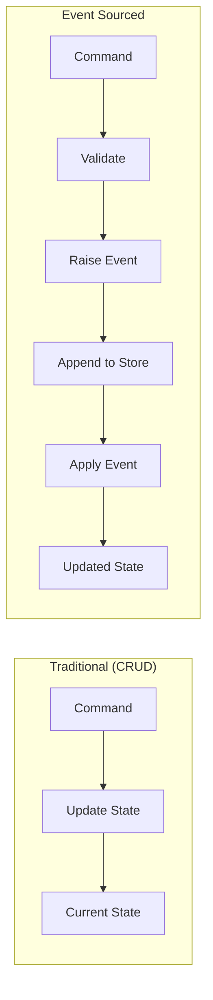
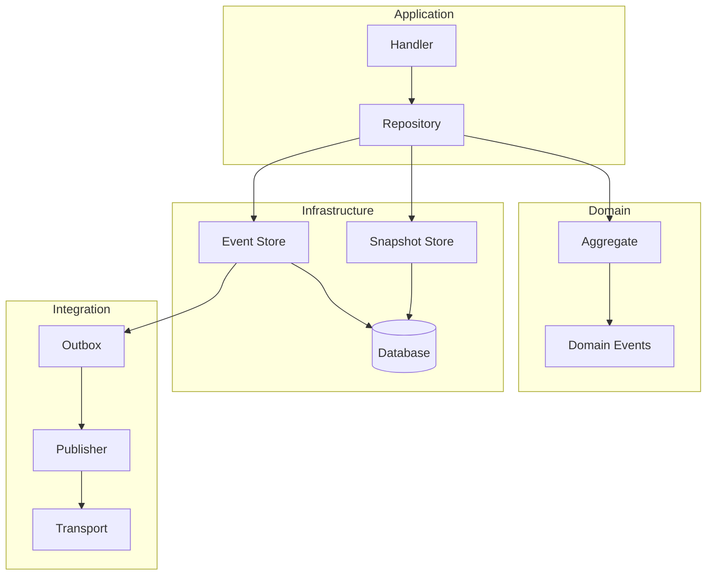

# Event Sourcing

Excalibur provides a complete event sourcing implementation with aggregates, event stores, snapshots, and projections.

**Start with the [EventStore walkthrough](walkthrough.md)** for one continuous path from a running
example through saves, projection consistency, versioning, recovery, and upgrades. This page provides
an overview; the other pages are detailed references.

:::info Why Should I Care?

Traditional CRUD overwrites state on every save -- you lose the history of *how* you got there. Event sourcing stores every change as an immutable event, giving you: **full audit trails** (who changed what, when), **temporal queries** (what was the state at any point in time), **easy debugging** (replay events to reproduce bugs), and **decoupled read models** (build multiple query-optimized views from the same event stream).
:::

## Before You Start

- **.NET 10.0**
- Install the required packages:
  ```bash
  dotnet add package Excalibur.Dispatch
  dotnet add package Excalibur.EventSourcing
  ```
- Familiarity with [handlers](../handlers.md) and [domain modeling](../domain-modeling/aggregates.md)

## Follow the application lifecycle

Start with the [walkthrough](walkthrough.md), then use these references as needed. Each step answers a different question:

1. **Choose storage and create its schema:** [providers](providers.md) and [database migrations](migrations.md).
2. **Define what happened and enforce business rules:** [domain events](domain-events.md) and [aggregates](aggregates.md).
3. **Load, change, and save an aggregate:** [consumer implementation](consumer-repository.md), followed by the [repository reference](repositories.md) for additional options.
4. **Build the query side:** [projections](projections.md), choosing Async, Inline, or explicitly transactional processing.
5. **Change an existing application:** [event payload versioning](versioning.md) for stored events; [projection evolution](projection-evolution.md) for new read models, replay, cutover, and rollback.
6. **Operate and upgrade it:** [snapshots](snapshots.md), [event-store operations](event-store.md), and the [alpha.19 checkpoint upgrade guide](../migration/alpha19-to-alpha20-sqlserver.md) when upgrading that schema.

### Which version am I changing?

| Concept | What it identifies | When you use it |
|---|---|---|
| Stream version / expected version | An aggregate's progress through its event history | Detect concurrent writes; the store assigns event positions within the stream. |
| Event payload version | The shape of one kind of stored event | Load older payloads through compatible defaults or upcasters. |
| Projection version / generation | A read-model definition and destination | Build changed models alongside existing ones, validate, then switch readers. |
| Database schema migration | Tables, columns, indexes, and constraints | Upgrade storage infrastructure; it does not upcast events or rebuild models. |

Changing one does not automatically perform the others. A CLR type rename is another separate concern:
keep its stored [message name](domain-events.md#stable-message-names) stable, or preserve historical names with aliases.

## Overview

Event sourcing captures all changes to application state as a sequence of events. Instead of storing current state, you store the history of state changes.



## Key Benefits

| Benefit | Description |
|---------|-------------|
| Complete audit trail | Every change is recorded with timestamp and metadata |
| Temporal queries | Query state at any point in time |
| Event replay | Rebuild state by replaying events |
| Debugging | Understand exactly how state evolved |
| Integration | Events naturally feed downstream systems |

## Aggregate example

For the runnable setup and its expected results, use the [walkthrough](walkthrough.md).
The following excerpts illustrate a richer order aggregate and its handlers.

### 1. Define Domain Events

Events extend the `DomainEvent` abstract record which provides `EventId`, `OccurredAt`, and `Metadata`. Each event declares the stable name it is stored and transmitted under with `[MessageName]` — see [Stable Message Names](domain-events.md#stable-message-names). An event carries only its own business data; the aggregate id is passed to the event store when appending, and the stream version is store-assigned:

```csharp
[MessageName("Contoso.Orders.OrderCreated")]
public record OrderCreated(Guid OrderId, string CustomerId, decimal TotalAmount) : DomainEvent;

[MessageName("Contoso.Orders.OrderShipped")]
public record OrderShipped(Guid OrderId, string TrackingNumber, DateTime ShippedAt) : DomainEvent;

[MessageName("Contoso.Orders.OrderCancelled")]
public record OrderCancelled(Guid OrderId, string Reason) : DomainEvent;
```

### 2. Create an Aggregate

```csharp
public class Order : AggregateRoot<Guid>
{
    public string CustomerId { get; private set; } = string.Empty;
    public decimal TotalAmount { get; private set; }
    public OrderStatus Status { get; private set; }
    public string? TrackingNumber { get; private set; }

    // Private constructor for rehydration
    private Order() { }

    // Creates the empty instance that the repository will populate from history.
    public static Order Rehydrate(Guid id) => new Order { Id = id };

    // Factory method for creation
    public static Order Create(Guid orderId, string customerId, decimal totalAmount)
    {
        var order = new Order();
        order.RaiseEvent(new OrderCreated(orderId, customerId, totalAmount));
        return order;
    }

    // Command methods
    public void Ship(string trackingNumber)
    {
        if (Status != OrderStatus.Created)
            throw new InvalidOperationException("Only created orders can be shipped");

        RaiseEvent(new OrderShipped(Id, trackingNumber, DateTime.UtcNow));
    }

    public void Cancel(string reason)
    {
        if (Status == OrderStatus.Shipped)
            throw new InvalidOperationException("Shipped orders cannot be cancelled");

        RaiseEvent(new OrderCancelled(Id, reason));
    }

    // Event application - uses pattern matching, no reflection
    protected override bool ApplyEventInternal(IDomainEvent @event) => @event switch
    {
        OrderCreated e => Apply(e),
        OrderShipped e => Apply(e),
        OrderCancelled e => Apply(e),
        _ => false
    };

    private bool Apply(OrderCreated e)
    {
        Id = e.OrderId;
        CustomerId = e.CustomerId;
        TotalAmount = e.TotalAmount;
        Status = OrderStatus.Created;
        return true;
    }

    private bool Apply(OrderShipped e)
    {
        TrackingNumber = e.TrackingNumber;
        Status = OrderStatus.Shipped;
        return true;
    }

    private bool Apply(OrderCancelled e)
    {
        Status = OrderStatus.Cancelled;
        return true;
    }
}
```

### 3. Configure Event Sourcing

```csharp
services.AddExcalibur(excalibur => excalibur.AddEventSourcing(builder =>
{
    // Register repositories with explicit factory
    builder.AddRepository<Order, Guid>(Order.Rehydrate);

    // Configure snapshot strategy (optional)
    builder.UseIntervalSnapshots(100); // Snapshot every 100 events

    // Or use composite strategy for more control
    // builder.UseCompositeSnapshotStrategy(s => s
    //     .AddIntervalStrategy(50)
    //     .AddTimeBasedStrategy(TimeSpan.FromMinutes(5))
    //     .RequireAll());
}));

// Add SQL Server event store (separate package)
services.AddSqlServerEventStore(opts => opts.ConnectionString = connectionString);
services.AddSqlServerSnapshotStore(opts => opts.ConnectionString = connectionString);
```

### 4. Use in Handlers

```csharp
public class CreateOrderHandler : IActionHandler<CreateOrderAction, OrderResult>
{
    private readonly IEventSourcedRepository<Order, Guid> _repository;

    public CreateOrderHandler(IEventSourcedRepository<Order, Guid> repository)
    {
        _repository = repository;
    }

    public async Task<OrderResult> HandleAsync(
        CreateOrderAction action,
        CancellationToken ct)
    {
        var order = Order.Create(
            Guid.NewGuid(),
            action.CustomerId,
            action.TotalAmount);

        await _repository.SaveAsync(order, ct);

        return new OrderResult(order.Id);
    }
}

public class ShipOrderHandler : IActionHandler<ShipOrderAction>
{
    private readonly IEventSourcedRepository<Order, Guid> _repository;

    public async Task HandleAsync(ShipOrderAction action, CancellationToken ct)
    {
        var order = await _repository.GetByIdAsync(action.OrderId, ct);

        if (order is null)
            throw new OrderNotFoundException(action.OrderId);

        order.Ship(action.TrackingNumber);

        await _repository.SaveAsync(order, ct);
    }
}
```

## Architecture



## Core Concepts

### Domain Events

Events represent facts that have happened. They are immutable and named in past tense.

```csharp
// Base interface
public interface IDomainEvent : IDispatchEvent
{
    string EventId { get; }
    DateTimeOffset OccurredAt { get; }
    IDictionary<string, object>? Metadata { get; }
    string? CorrelationId { get; }
    string? CausationId { get; }
}

// Convenient base record with auto-generated defaults
public abstract record DomainEvent : IDomainEvent
{
    public virtual string EventId { get; init; } = Guid.NewGuid().ToString();
    public virtual DateTimeOffset OccurredAt { get; init; } = DateTimeOffset.UtcNow;
    public virtual IDictionary<string, object>? Metadata { get; init; }
    public virtual string? CorrelationId { get; init; }
    public virtual string? CausationId { get; init; }
}

// The event's stored name is declared with [MessageName] on each event type —
// nothing is derived from the CLR type. See "Stable Message Names" in Domain Events.
//
// The aggregate id is supplied to the event store on append/load; the stream
// version is store-assigned and surfaced on the envelope during replay
// (HistoricEvent.Version / StoredEvent.Version) — never read from the event itself.
```

### Aggregates

Aggregates enforce business rules and emit events when state changes.

```csharp
public abstract class AggregateRoot<TKey> : IAggregateRoot<TKey>
{
    public TKey Id { get; protected set; }
    public long Version { get; protected set; }
    public string? ETag { get; set; }

    public IReadOnlyList<IDomainEvent> GetUncommittedEvents();
    public void MarkEventsAsCommitted();
    public void LoadFromHistory(IEnumerable<HistoricEvent> history);

    protected void RaiseEvent(IDomainEvent @event);
    protected abstract bool ApplyEventInternal(IDomainEvent @event);
}
```

### Event Store

Persists events with optimistic concurrency control.

```csharp
public interface IEventStore
{
    ValueTask<IReadOnlyList<StoredEvent>> LoadAsync(
        string aggregateId,
        string aggregateType,
        CancellationToken cancellationToken);

    ValueTask<AppendResult> AppendAsync(
        string aggregateId,
        string aggregateType,
        IEnumerable<IDomainEvent> events,
        long expectedVersion,
        CancellationToken cancellationToken);
}
```

## Recommended Reading Order

1. **[Domain Events](domain-events.md)** -- Start here. Define the events that describe what happens in your domain.
2. **[Aggregates](aggregates.md)** -- Build aggregates that enforce business rules and raise events.
3. **[Repositories](repositories.md)** -- Load and save aggregates, understand save outcomes, and handle concurrency.
4. **[Event Store](event-store.md)** -- Persist and load event streams directly when needed.
5. **[Snapshots](snapshots.md)** -- Optimize loading for aggregates with many events.
6. **[Projections](projections.md)** -- Build query-optimized read models from event streams.
7. **[Providers](providers.md)** -- Choose and configure your database provider.
8. **[Event Versioning](versioning.md)** -- Handle event schema changes over time.
9. **[Projection Evolution](projection-evolution.md)** -- Populate changed models and switch readers safely.
10. **[Materialized Views](materialized-views.md)** -- Schedule-driven analytics views.
11. **[Migrations](migrations.md)** -- Schema migrations CLI tool.

## See Also

- [Patterns](../patterns/index.md) - Outbox pattern for reliable event publishing
- [Handlers](../handlers.md) - Command and event handler patterns
- [Package Guide](../package-guide.md) - Understanding which packages you need for event sourcing
