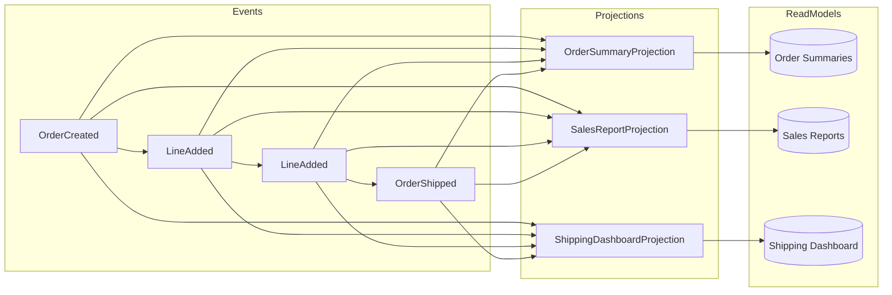
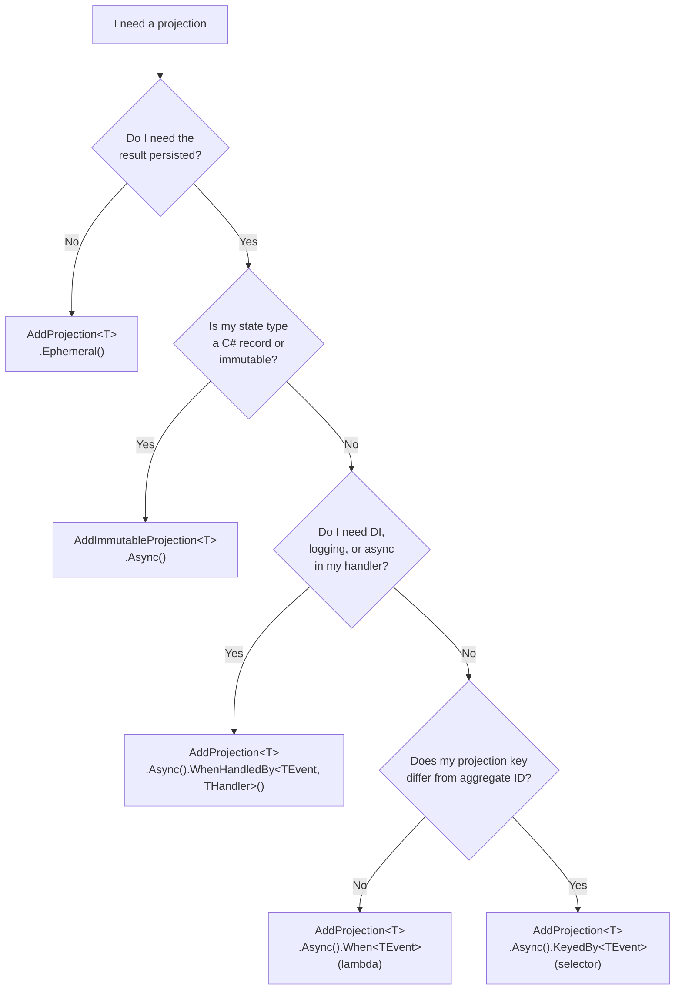
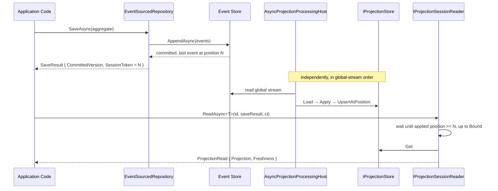

# Projections

Projections transform event streams into read-optimized views (read models) for queries.

## Before You Start

- **.NET 10.0**
- Install the required packages:
  ```bash
  dotnet add package Excalibur.EventSourcing
  ```
- Familiarity with [event stores](./event-store.md) and [domain events](./domain-events.md)

## Overview



## Quick start: Inline in one application or several

```csharp
services.AddExcalibur(x => x.AddEventSourcing(es =>
{
    es.UseSqlServer(sql => sql.ConnectionString(connectionString));
    es.AddRepository<OrderAggregate, Guid>(id => new OrderAggregate(id));
    es.AddProjection<OrderSummary>(p => p.Inline()
        .When<OrderPlaced>((view, e) => view.Total += e.Amount));
}));
services.AddElasticSearchProjectionStore<OrderSummary>("http://localhost:9200");
```

Use the same registration in the API, Jobs, or both. `.Inline()` automatically registers recovery in
each host; it does not require `EnableProjectionProcessing()` or an `IProjectionProcessor` call.
SQL Server supplies a checkpoint store bound to its event source. Deploy the provider's event-store
and subscription-checkpoint schema migrations before startup; registration does not create SQL tables.

After the event commit, the processor reads the complete ordered prefix through the returned commit
position. It folds each affected document once per page and uses conditional positioned writes.
Cooperating processes can attempt the same page, but a stale writer cannot overwrite the winning fold.
Successful completion includes the store's configured query-visibility barrier. For immediate
Elasticsearch **search**, enable `Index.EnsureSearchVisibilityOnProjectionCheckpoint` on the store.

When completion IS confirmed, `SaveResult.Projections` is `ProjectionFreshness.Attested`: the save
**observed** its required projections caught up, against the durable roster as it stood at that
moment. That is a receipt, not a standing promise -- the roster can change before you read, so
`Attested` on its own is **not** read-your-own-writes. For that, carry the `SessionToken` into
`IProjectionSessionReader` and require `ProjectionFreshness.Fresh`, which is issued only after the
reader re-validates roster identity, binding, position and destination around the data read.

If completion cannot be confirmed, the save still succeeds and reports it: `SaveResult.Projections` is
`ProjectionFreshness.BoundExpired` and the same `SaveResult` carries the `SessionToken`. The events are
already durable: retry the read, not the command. Recovery
resumes automatically while a host is running, including after restart. A poison handler requires a
handler/data repair; a previously unpositioned row still requires a deliberate rebuild.
Each projection retains its own durable cursor. A failed projection retries its missing prefix on
later recovery rounds, even after repeated failures, while healthy projections continue from their
own cursors. Destination-discovery failures are isolated per projection during processing as well.
Foreground saves resolve and process only their required projections, so an unrelated slow provider
does not consume the save's completion budget. Startup still validates every registered destination.
Whole-subscription completion requires every projection to catch up; a session read
checks only the requested projection's confirmed progress.

The foreground wait uses `EventNotificationOptions.PostCommitTimeout`, independent of request
cancellation after commit. Provider I/O must eventually finish or honor cancellation; an unfinished
operation retains its scope and processing lease. Notification-handler failures retain their own policy.

Automatic scope discovery supports the connection-string SQL Server registration and options-based
Elasticsearch registration. For a custom source, externally supplied client, or tenant router, configure
a durable checkpoint store and an explicit `GlobalStreamProjectionOptions.SubscriptionScope` shared by
cooperating hosts. Different configured endpoint sets fail closed; endpoint aliases are not proof that
two hosts address the same cluster. Separate applications sharing one event database should use
different `ProjectionName` values. Inline checkpoints use an `Inline:` prefix, separate from Async.

See [Inline migration](../migration/projections-are-applied-by-the-host.md) before switching an existing
subscription or destination. The examples below also cover the explicitly managed Async option.

## Generated metadata for native AOT

Use the metadata overloads for persisted Inline or Async projections:

```csharp
services.AddAotEventSerializer(AppJson.Default);
services.AddElasticSearchProjectionStore<OrderSummary>(options =>
{
    options.NodeUri = elasticsearchUri;
    options.SourceTypeInfoResolver = AppJson.Default;
});
// Inside AddEventSourcing:
es.UseSqlServer(sql => sql.ConnectionString(connectionString)
    .EventTypeInfoResolver(AppJson.Default));
es.AddProjection(AppJson.Default.OrderSummary, p => p.Inline()
    .When<OrderPlaced>((view, e) => view.Total += e.Amount));
// After saving:
var read = await sessionReader.ReadAsync(orderId, save, AppJson.Default.OrderSummary, ct);
```

Include event and projection types in `AppJson`, a source-generated `JsonSerializerContext`.
Use the same context instance for the store and projection registration. Elasticsearch retains its
existing source serialization conventions, including camelCase fields and string enums. The outer
store must expose `IAotProjectionStore<T>` and the positioned-write capability; unsupported decorators
and unverified injected clients fail before processing. The generated overload requires
`AddAotEventSerializer` and rejects Ephemeral mode, whose cache does not yet consume this metadata.

These overloads remove the projection API's reflection requirement. They do not certify dependencies:
the full SQL Server-to-Elasticsearch strict native publish remains blocked by diagnostics in official
SqlClient 7.1.1 and its configuration paths. Keep AOT/trimming warnings as errors for release builds.
This dependency limitation is accepted for this alpha, but the complete path is not Native AOT
certified. Use a JIT deployment for SQL Server-to-Elasticsearch projections until an official SqlClient
release passes strict publishing and the API-only, Jobs-only, cooperating-host and outage-recovery tests.

## Choosing the Right Approach

Excalibur offers several projection approaches. Use this decision tree to pick the right one:



Choose `.Inline()` when a successful save must confirm its read models before returning. It registers
foreground completion and background recovery automatically in each application. Choose `.Async()` for
independent background processing, with an explicit host or processor. Both use ordered, positioned
writes; `.Ephemeral()` folds on demand without persistence.

### Quick Comparison

| Approach | State Type | DI Support | Best For |
|----------|------------|------------|----------|
| **`Async` lambda** | Mutable class | No | Simple property mapping |
| **`Async` + `KeyedBy`** | Mutable class | No | Multi-stream aggregation (category, tenant) |
| **`Async` DI handler** | Mutable class | Yes | Complex logic, logging |
| **`Async` immutable** | Records, immutable | Yes | Functional patterns, audit trails |
| **`Ephemeral`** | Any | No | Debugging, ad-hoc queries |

An `Async` projection is stored and is written by the projection host. An `Ephemeral` projection is
folded from the stream on each request and is never stored.

---

## Async configuration and explicit processing

The preferred approach for organizing projections. Each projection gets its own configuration class, discovered automatically via assembly scanning:

```csharp
// 1. Define your projection configuration class
public class OrderSummaryProjectionConfig : IProjectionConfiguration<OrderSummary>
{
    public void Configure(IProjectionBuilder<OrderSummary> builder)
    {
        builder.Async()
            .When<OrderPlaced>((proj, e) =>
            {
                proj.Status = "Placed";
                proj.Total = e.Total;
                proj.CreatedAt = e.OccurredAt;
            })
            .When<OrderShipped>((proj, e) =>
            {
                proj.Status = "Shipped";
                proj.ShippedAt = e.ShippedAt;
            });
    }
}

// 2. Register all projections via assembly scanning
services.AddExcalibur(excalibur => excalibur.AddEventSourcing(builder =>
{
    builder.UseInMemory().AddRepository<OrderAggregate, Guid>();
    builder.AddProjectionsFromAssembly(typeof(OrderSummary).Assembly);
}));

// 3. Say WHERE each projection is stored. AddProjection says what a projection folds; it does not
//    give it anywhere to live, and the host refuses to start if nothing does.
services.AddInMemoryProjectionStore<OrderSummary>();

// 4. Say WHAT APPLIES them. Nothing writes a projection without this, and nothing complains.
services.AddExcalibur(excalibur => excalibur.AddEventSourcing(builder =>
    builder.EnableProjectionProcessing(options => options.SubscriptionScope = "orders/events/read-models")));
```

:::info Async requires an explicit processor

An `.Async()` projection needs all three:

| registration | says | if you omit it |
|---|---|---|
| `AddProjection<T>()` or assembly scanning | **what it folds** | nothing folds the events |
| a store registration | **where it lives** | **start-up fails**, naming the projection |
| `EnableProjectionProcessing()` | **what applies it** | **start-up succeeds and the read model never updates** |

The third is the one to watch, and it is the trap for anyone converting an older registration.
`AddProjection<T>(p => p.Async())` registers a projection; it does not register anything that writes
one. Omit `EnableProjectionProcessing()` and your application starts, reports healthy, serves reads, and
every one of them is empty — indefinitely. Nothing throws, because nothing failed: you asked for a
projection and never asked for the host that applies it.

A host that should not run a background poller calls `AddProjectionProcessor()` instead and drives the
work itself. That is the right registration in two cases: a host that *cannot* run a `BackgroundService`
at all (an Azure Function, a Lambda), and a host that wants its read models current by the time a request
returns. See [Hosts that drive projections themselves](#hosts-that-cannot-run-a-background-service).

:::

:::warning The projection table's columns are decided by the STORE, not by your projection type

A SQL projection store keeps the projection body as JSON in a single `Data` column. A table with
columns named after your projection's own properties will create, deploy, and then fail at the first
apply with `Invalid column name 'Data'` — against your database, which is the one place this
framework cannot see.

Do not hand-write it. Either run the shipped template beside your provider's other migrations
(`Scripts/005_CreateProjectionSchema.sql`), replacing its one token, or generate the script:

```csharp
// SQL Server
var ddl = SqlServerProjectionSchema.CreateTableScript("OrderSummary");

// Postgres -- lowercase columns, JSONB body
var ddl = PostgresProjectionSchema.CreateTableScript("order_summary");
var inAnotherSchema = PostgresProjectionSchema.CreateTableScript("order_summary", "reporting");
```

The two differ in more than naming: Postgres stores the body as `JSONB`, and its column names are
lowercase because the store references them unquoted (an unquoted identifier folds to lower case, so
a quoted mixed-case column would be unreachable). Both providers take a schema — `dbo` on SQL Server,
`public` on Postgres — and it must match the store's configured schema, because every statement the
store runs is schema-qualified. On Postgres the schema and table are **quoted**, so their case is
preserved exactly as written: `"Reporting"` is not `"reporting"`.

Prefer the generated form: it is emitted from the provider's own schema, so it cannot drift from the
queries the store runs. The position column is the one nobody guesses correctly — it must be
`NOT NULL` defaulting to `-2`, because `0` is a legitimate stream position and a `NULL` compares
equal to nothing in the compare-and-set that orders two concurrent writers.

The store does **not** create the table for you. A store that silently created a missing table would
also create it in the wrong database when a connection string is wrong, and a projection reading an
empty table it just made is indistinguishable from one that is merely behind.

:::

:::info Picking a store

For a real backend, swap the in-memory store for a provider — see
[Registering Store Backends](#registering-store-backends). `AddInMemoryProjectionStore<T>()` is for
development, tests and samples: it keeps nothing after the process exits and is **not tenant-confined**.
Its destination scope belongs to that store instance. Replacing it while retaining durable checkpoints
is rejected; keep events, projections, and checkpoints in memory together, or use a durable projection
store with durable checkpoints. Clearing only a checkpoint position does not replace its lifetime binding.

:::

### Tenant boundaries during global-stream processing

A projection checkpoint belongs to the actual destination, including its tenant partition. The
processor validates the authoritative tenant recorded on each handled event before invoking any
handler in a batch. A missing tenant is unknown; it never inherits the caller's ambient tenant.
The explicit `__untenanted__` partition remains distinct from estate-wide storage.

| Projection store | Enforced storage boundary |
|---|---|
| SQL Server, PostgreSQL | The resolved tenant's row partition |
| Cosmos DB, DynamoDB, Elasticsearch, Firestore, MongoDB, OpenSearch | Estate-wide; no built-in tenant row isolation |
| In-memory | Estate-wide, confined to one store instance's lifetime |

A tenant-confined projection requires a source whose handled events belong to that partition. A
mixed-tenant global stream is rejected before batch side effects; the processor does not switch the
ambient tenant or silently skip another tenant's events. Use an explicitly estate-wide read model for
estate-wide processing, or an isolated source and subscription for each tenant. Tenant-to-shard routing
alone does not prove isolation when tenants share a shard. Wrapping an estate-wide store in a tenant
presence guard does not add a tenant predicate.

Custom projection stores used by persisted processing, rebuilds, or consistent reads must expose
`IProjectionTenantBoundary` through their outer `IServiceProvider.GetService` capability chain. Return
`ProjectionTenantBoundary.EstateWide` only for an intentionally estate-wide store, or
`ProjectionTenantBoundary.Partition(actualTenantId)` for a partition the store actually enforces.
Partitioned custom stores must also expose their actual storage scope through
`IProjectionDestinationScope` or `IAsyncProjectionDestinationScope`. An explicit `SubscriptionScope`
does not replace this requirement: without the destination scope, a tenant change could reuse another
tenant's checkpoint. Separate subscription names alone do not filter a shared global stream.
Unknown capabilities fail closed. Decorators must preserve this declaration without exposing raw
inner data access. The framework includes the boundary in binding and freshness checks; changing it
cannot reuse another partition's progress.

For `.Async()`, `SaveAsync` does not wait for the projection, so an immediate read may not see it yet. Carry
the token the save returned, and the read waits:

```csharp
var save = await repository.SaveAsync(order, cancellationToken);

var read = await sessionReader.ReadAsync<OrderSummary>(
    order.Id.ToString(), save, cancellationToken);

// read.Freshness is Fresh when the projection had applied this save before the read returned.
var summary = read.Projection;
```

[Reading Your Own Writes](#reading-your-own-writes-session-consistency) covers the token, the bound, and
what to do when the bound expires.

### Why IProjectionConfiguration&lt;T&gt;?

| Benefit | Description |
|---------|-------------|
| **Organized** | Each projection lives in its own file, easy to navigate |
| **Testable** | Configuration classes can be unit-tested in isolation |
| **Discoverable** | Assembly scanning finds all projections automatically |
| **Scalable** | No single giant DI registration block as projections grow |

:::warning AOT Compatibility

`AddProjectionsFromAssembly` uses reflection and is annotated with `[RequiresUnreferencedCode]`. For AOT/trimming scenarios, use explicit `AddProjection<T>()` calls with lambda handlers instead.
:::

---

## Quick Start: Lambda Registration (Alternative)

For simple cases or AOT scenarios, register projections directly with lambda handlers:

```csharp
services.AddExcalibur(excalibur => excalibur.AddEventSourcing(builder =>
{
    builder.UseInMemory().AddRepository<OrderAggregate, Guid>();

    builder.AddProjection<OrderSummary>(p => p
        .Async()
        .When<OrderPlaced>((proj, e) =>
        {
            proj.Status = "Placed";
            proj.Total = e.Total;
            proj.CreatedAt = e.OccurredAt;
        })
        .When<OrderShipped>((proj, e) =>
        {
            proj.Status = "Shipped";
            proj.ShippedAt = e.ShippedAt;
        }));

    builder.EnableProjectionProcessing(options => options.SubscriptionScope = "orders/events/read-models");
}));
```

This approach is best for:
- Small projects with few projections
- AOT/trimming scenarios where reflection is unavailable
- Quick prototyping

---

## Mutable Projections

`AddProjection<T>()` folds events into a mutable class with a parameterless constructor (`new()`
constraint). The projection host loads the row, applies the handlers below, and writes it back — reading
the global stream in order, using positioned compare-and-set writes to cooperate across processes.

### Lambda Handlers (Tier 1)

Lambda handlers invoke registered delegates without resolving a separate handler through DI. They suit simple property mapping; the callback and the rest of projection processing can still allocate:

```csharp
builder.AddProjection<OrderSummary>(p => p
    .Async()
    .When<OrderPlaced>((proj, e) => { proj.Status = "Placed"; proj.Total = e.Total; })
    .When<OrderShipped>((proj, e) => { proj.Status = "Shipped"; }));
```

### Giving a Projection Its Own Identity

Domain events do not carry the aggregate identifier — the stored envelope is authoritative for it. A
third handler parameter supplies it:

```csharp
builder.AddProjection<OrderSummary>(p => p
    .Async()
    .When<OrderPlaced>((proj, e, ctx) =>
    {
        proj.Id = ctx.AggregateId ?? string.Empty;   // which order this projection describes
        proj.Total = e.Total;
    }));
```

`ProjectionContext` also exposes `IsReplay` and `GlobalPosition`, so the same overload is how you skip
side effects during a rebuild.

:::warning A projection that does not store its identity cannot be acted on
Projection stores key the stored document by the projection ID, but **a read returns the document body
alone**. An identifier that was never written into the body is not available to the caller.

The symptom is not an error. A client loads a projection to populate an edit screen, gets every field
except the one identifying what it loaded, and has nothing to send to an update command. If you assign
`Id` from a property that no longer exists, you get an empty string and a read model that looks
correct until someone tries to change it.
:::

#### Not Exposing Aggregate IDs to Clients

Storing the identity in the projection does not mean publishing it. The projection is an internal read
model, not a wire contract — map to a response DTO at the edge and expose whatever you choose.

What you cannot do is omit identity altogether: an update command has to load *some* aggregate, so the
round trip needs a stable correlator. Three workable shapes, and one to avoid:

| approach | how the update handler resolves the aggregate |
|---|---|
| **Opaque handle** (recommended) | Return a signed or encrypted token instead of the raw ID; decode it server-side. Identity is preserved, never exposed, and tamper-evident. |
| **Identity map** | Map an external reference to the internal aggregate ID via `Excalibur.Data.IdentityMap`, which exists for exactly this. |
| **Natural key** | Look up by something the client legitimately knows — an order number. The key must be unique *and* immutable; email addresses and names are usually neither. |
| ~~Match on several properties~~ | **Avoid.** It appears to work, and silently updates the wrong aggregate the first time two records share those values. |

All three supported shapes still require the projection to know its own aggregate ID — the opaque
handle and the identity map both need something to map *from*.

### Multi-Stream Projections (KeyedBy)

By default, a projection is keyed by aggregate ID -- each aggregate gets its own projection instance. Use `KeyedBy<TEvent>()` to derive the projection key from event data instead, enabling projections that aggregate across multiple streams:

```csharp
builder.AddProjection<CategorySummaryProjection>(p => p
    .Async()
    .KeyedBy<ProductCreated>(e => e.Category.ToUpperInvariant())
    .KeyedBy<ProductPriceChanged>(e => e.Category.ToUpperInvariant())
    .KeyedBy<ProductStockAdded>(e => e.Category.ToUpperInvariant())
    .When<ProductCreated>((proj, e) =>
    {
        proj.CategoryName = e.Category;
        proj.TotalProducts++;
        proj.ActiveProducts++;
    })
    .When<ProductPriceChanged>((proj, e) =>
    {
        proj.ProductPrices[e.ProductId.ToString()] = e.NewPrice;
    })
    .When<ProductStockAdded>((proj, e) =>
    {
        proj.ProductStocks[e.ProductId.ToString()] = e.NewStockLevel;
    }));
```

All products in "Electronics" share one `CategorySummaryProjection` instance, loaded and saved by the projection host as it applies each event. No manual handler classes or `GetUncommittedEvents()` loops needed.

**Key rules:**

- Register a `KeyedBy` selector for every event type that should route to a custom key. Events without a selector fall back to aggregate ID.
- The key selector must return a non-null, non-empty string.
- Events must carry the data needed for key derivation (e.g., a `Category` property on the event record).
- `KeyedBy` works with both `When<T>` lambdas and `WhenHandledBy<T, THandler>` DI handlers.

:::tip When to use KeyedBy vs OverrideProjectionId

Use `KeyedBy` when the key can be derived purely from event data -- it works with all handler tiers and keeps registration declarative. Use `OverrideProjectionId` (Tier 3 only) when the key requires DI services, async lookups, or runtime logic beyond the event.
:::

#### Choosing a Key That Is Not the Aggregate ID

The storage key and the aggregate identity are separate concepts, and a projection can carry both —
key by whatever the read model is *about*, and keep the originating aggregate as an ordinary property:

```csharp
builder.AddProjection<RegionSummary>(p => p
    .Async()
    .KeyedBy<CustomerCreated>(e => e.Region)
    .When<CustomerCreated>((view, e, ctx) =>
    {
        view.Region       = e.Region;          // what this document is about (the key)
        view.LastCustomer = ctx.AggregateId;   // where this event came from
    }));
```

**Key by something the domain already means.** A region, a tenant, a date, an invoice number assigned
by the aggregate — these are stable facts, and a rebuild reproduces exactly the same keys.

**Avoid keying by insertion order.** An auto-incrementing counter is tempting as a "tidier" id, and it
breaks in a specific way worth understanding: projections are rebuilt from the event stream, so on the
next rebuild the counter restarts and every document lands under a different key than before. Anything
that stored one of those ids now points at the wrong row. Ordinal position is a coincidence of when
you happened to process something, and a rebuild does not preserve coincidences — whereas an aggregate
ID, a region or an invoice number reproduces identically every time.

If the motive for a synthetic key is to avoid exposing aggregate IDs to clients, that belongs at the
API edge instead — see [Not Exposing Aggregate IDs to Clients](#not-exposing-aggregate-ids-to-clients).
Changing the storage key to hide a value changes your persistence model to solve a serialization
concern.

### DI-Resolved Handlers (Tier 3)

When your projection logic needs dependency injection, async operations, or custom projection IDs, implement `IProjectionEventHandler<TProjection, TEvent>`:

```csharp
public sealed class CustomerCreatedHandler
    : IProjectionEventHandler<CustomerSearchProjection, CustomerCreated>
{
    private readonly ILogger<CustomerCreatedHandler> _logger;

    public CustomerCreatedHandler(ILogger<CustomerCreatedHandler> logger)
        => _logger = logger;

    public Task HandleAsync(
        CustomerSearchProjection projection,
        CustomerCreated @event,
        ProjectionHandlerContext context,
        CancellationToken cancellationToken)
    {
        projection.Name = @event.Name;
        projection.Email = @event.Email;
        projection.IsActive = true;
        _logger.LogDebug("Projected customer {Id}", context.AggregateId);
        return Task.CompletedTask;
    }
}
```

Register with `WhenHandledBy`. You can mix lambdas and DI handlers in the same projection:

```csharp
builder.AddProjection<CustomerSearchProjection>(p => p
    .Async()
    .WhenHandledBy<CustomerCreated, CustomerCreatedHandler>()
    .WhenHandledBy<CustomerOrderPlaced, CustomerOrderPlacedHandler>()
    .When<CustomerDeactivated>((proj, e) => { proj.IsActive = false; }));
```

`WhenHandledBy` auto-registers the handler in DI as `Transient` -- no manual `services.AddTransient<THandler>()` needed.

:::info Handler dependencies are checked at start-up

Registering the handler makes the handler itself resolvable. It says nothing about the services the
handler asks for in its own constructor, and that is where the common mistake is: a handler that reads
another projection to build the one it writes needs *that* projection's store registered too.

The host refuses to start when it cannot supply a registered handler's constructor dependencies, naming
the handler and the dependency:

```text
The following projection event handler cannot be constructed, because nothing registers
the services they ask for:

  CustomerOrderPlacedHandler (folds CustomerSearchProjection) needs
  IProjectionStore<ProductCatalogProjection> catalog
```

Without that check the handler resolves on the first event instead -- which for an async projection
happens inside a background host, after the events are already durable and with no request to fail.

A genuinely optional dependency is a supported shape: give the constructor parameter a default value
and the check skips it. Dependencies the container manufactures without a registration --
`IServiceProvider`, `IServiceScopeFactory`, and `IEnumerable<T>` of anything -- are always considered
available.
:::

### Assembly Scanning

For projects with many handlers, scan an assembly to auto-discover all `IProjectionEventHandler<T, TEvent>` implementations:

```csharp
builder.AddProjection<CustomerSearchProjection>(p => p
    .Async()
    .AddProjectionHandlersFromAssembly(typeof(CustomerCreatedHandler).Assembly));
```

:::warning AOT Compatibility

Assembly scanning uses reflection and is annotated with `[RequiresUnreferencedCode]`. For AOT/trimming scenarios, use explicit `WhenHandledBy<TEvent, THandler>()` instead.
:::

### Custom Projection IDs (OverrideProjectionId)

For Tier 3 DI handlers, `OverrideProjectionId` provides an escape hatch when the key cannot be derived from event data alone. Prefer [`KeyedBy`](#multi-stream-projections-keyedby) for most multi-stream scenarios.

```csharp
public sealed class TierSummaryOnCustomerCreated
    : IProjectionEventHandler<TierSummaryProjection, CustomerCreated>
{
    public Task HandleAsync(
        TierSummaryProjection projection,
        CustomerCreated @event,
        ProjectionHandlerContext context,
        CancellationToken cancellationToken)
    {
        context.OverrideProjectionId = "Bronze"; // Key by tier, not aggregate
        projection.CustomerCount++;
        return Task.CompletedTask;
    }
}
```

:::info Your handler must be idempotent, and an override makes that concrete

A handler that sets an override writes to **two** projection ids from one event — the aggregate's own
row and the overridden one — so the framework invokes it **once per target**. Those two rows advance
independently, and each one decides for itself whether it has already folded a given event.

That means the handler can be invoked for an event one of its targets already holds, so the other
target can be offered it. On that invocation the projection instance it receives is a throwaway whose
fold is discarded; anything your handler does **outside** the projection state happens again. Keep
those effects idempotent, or guard them with `context.IsReplay` where that is the right distinction.

This only affects the redelivery window, not the steady state — but it is a property of the capability,
not an accident, and `KeyedBy` avoids it entirely because the key is derived without running anything.
:::

### ProjectionHandlerContext

Every DI handler receives aggregate metadata:

```csharp
public sealed class ProjectionHandlerContext
{
    public string AggregateId { get; }
    public string AggregateType { get; }
    public long CommittedVersion { get; }
    public DateTimeOffset Timestamp { get; }
    public string? OverrideProjectionId { get; set; }
}
```

### Handler Tier Comparison

| Tier | API | DI | Async | Custom ID | AOT-Safe | Best For |
|------|-----|-----|-------|-----------|----------|----------|
| 2 | **`IProjectionConfiguration<T>`** (recommended) | No | No | Via `KeyedBy` | No (reflection) | Organized, scalable projection definitions |
| 1 | `When<TEvent>(lambda)` | No | No | Via `KeyedBy` | Yes | Simple property mapping, AOT scenarios |
| 3 | `WhenHandledBy<TEvent, THandler>()` | Yes | Yes | `KeyedBy` + `OverrideProjectionId` | Yes | Complex logic, logging, cross-aggregate |

### Performance

| Scenario | Work to include in measurements |
|----------|---------------------------------|
| `When<T>` lambda (Tier 1) | Delegate invocation and callback work |
| `WhenHandledBy` singleton handler | DI lookup, any required initialization and handler execution |
| `WhenHandledBy` transient handler | DI lookup, handler construction and execution |

When all handlers in a projection are Tier 1 lambdas and no `KeyedBy` selectors are registered, the pipeline avoids multi-ID dictionary tracking. Adding `KeyedBy` selectors or any Tier 3 handler activates the multi-ID code path with `Dictionary<string, TProjection>` tracking. This distinction does not guarantee zero allocations: selectors, callbacks, handler dependencies, stores and the rest of projection processing can allocate. Measure the complete projection workload with the configured lifetimes and store before publishing latency or allocation values.

### Reading Your Own Writes (Session Consistency)

**The save does not wait for a projection. The read does, and only if you ask it to.** A save returns a
token; carrying that token to the read makes the read observe the write that produced it.

This is the shape Azure Cosmos DB uses for session consistency, and for the same reason: making every
save wait for every read model puts that latency on the saves nobody ever reads back. Here only the
caller who needs the guarantee pays for it, and a caller that passes no token waits for nothing.

#### The pipeline



#### End to end

```csharp
public async Task<IResult> PlaceOrder(PlaceOrder command, CancellationToken ct)
{
    var order = Order.Place(command);

    // 1. Save. The token is the global position of the LAST event this save wrote.
    SaveResult save = await _repository.SaveAsync(order, ct);

    // 2. Carry it to the read. The reader waits until the projection has applied that position.
    ProjectionRead<OrderSummary> read =
        await _sessionReader.ReadAsync<OrderSummary>(order.Id.ToString(), save, ct);

    // 3. Branch on what the read could establish.
    return read.Freshness switch
    {
        ProjectionFreshness.Fresh        => Results.Ok(read.Projection),
        ProjectionFreshness.BoundExpired => Results.Accepted(value: read.Projection),
        _                                => Results.Ok(read.Projection),
    };
}
```

`IProjectionSessionReader` is registered for you by `AddProjection<T>()` (and by
`UseEventNotification()`), so there is nothing extra to wire. Inject it like any other service.

:::tip Working code for this whole sequence

[`ProjectionsSample`](https://github.com/TrigintaFaces/Excalibur/tree/main/samples/09-advanced/persistence-patterns/ProjectionsSample) runs it end to end with no
infrastructure: it registers `.Async()` projections and the host, saves, drives
`IProjectionProcessor.ProcessPendingAsync`, reads the last write back through its `SaveResult`, and
prints the resulting `Freshness`. It is the one place in the repository that **executes** the
session-consistent read rather than describing it.

:::

#### SaveResult

```csharp
public readonly record struct SaveResult(
    long CommittedVersion,
    long? SessionToken,
    ProjectionFreshness Projections);
```

| member | meaning |
|---|---|
| `CommittedVersion` | the aggregate's version after the save |
| `SessionToken` | the global position of the **last** event this save wrote |
| `Projections` | what the save could establish about its `Inline` projections: `Attested` (observed caught up, against the roster as it then stood), `BoundExpired` (behind), `NotRequested` (nothing was owed) or `Deferred` (you suppressed the wait) |

`SessionToken` is `null` when the event store assigns no global ordering, or when the save wrote
nothing. **That is a real answer, not a missing one:** it means there is no coordinate to wait on, so a
consistent read cannot be requested against this write. It does not mean the save failed.

#### ProjectionFreshness

`ReadAsync` returns `ProjectionRead<T>`, which carries the value **and** what the read could establish
about it. It never throws for staleness and never returns a bare `bool`.

| `Freshness` | what happened | what to do |
|---|---|---|
| `NotRequested` | no token was supplied, so nothing was waited for | treat it as an ordinary, possibly stale read |
| `Fresh` | the projection had applied the token's position before the read | trust it against your own write |
| `BoundExpired` | the projection had **not** reached the token within `Bound` | the value may predate your write — retry, surface it, or serve it as stale |

`BoundExpired` is deliberately not an exception. A projection being behind is something a caller may
reasonably choose to tolerate, and throwing would make the common *show slightly stale data rather than
fail* choice the awkward one. It also does not mean the save failed: the events are durable either way.

`read.Projection` is `null` when no row exists for that id — which, on a fresh `Fresh` read, means the
handlers folded nothing for that key.

#### Configuring the bound

```csharp
services.Configure<ProjectionSessionOptions>(o =>
{
    o.Bound        = TimeSpan.FromSeconds(5);        // default; 50 ms .. 2 minutes
    o.PollInterval = TimeSpan.FromMilliseconds(25);  // default; 1 ms .. Bound
});
```

| option | default | range | notes |
|---|---|---|---|
| `Bound` | 5 seconds | 50 ms – 2 minutes | how long a consistent read waits before reporting `BoundExpired` |
| `PollInterval` | 25 ms | 1 ms – `Bound` | how often the read re-checks the projection's progress |

**Raising `Bound` does not make a stopped projection start; it makes the request hang while one is
stopped.** If reads are routinely reporting `BoundExpired`, the projection is behind or halted — look at
the lag metric and the host, not at this number.

The read waits on the greater of the in-process applied mark and the durable checkpoint, because neither
alone is sufficient: the in-process mark moves the instant a batch applies but knows only this process,
while the durable checkpoint is shared across processes and advances after every fully applied page.

#### What this model costs, and what it bought

Be clear about the trade, in both directions.

| | the old save-time write | this model |
|---|---|---|
| when the read model is written | during `SaveAsync` | by the projection host, afterwards |
| what a read costs with no token | nothing | nothing |
| what a read costs with a token | n/a | waits until the projection catches up, bounded |
| what a save costs | the projection I/O, on every save | nothing |
| concurrent saves to one projection row | **both folded, last write won** | committed global order, positioned writes and checkpoint CAS |

The old model advertised immediate consistency and had a silent hole underneath it: two saves whose
events keyed to the same projection row each read that row, each folded their own events into it, and the
last write won. **Both saves reported success, and the events the losing fold carried stayed durable in
the event store and permanently absent from the read model.** Nothing downstream ever learned.

Positioned conditional writes prevent that stale-state overwrite; competing readers reconcile their durable progress. The cost is that a read
needing its own write may have to wait, bounded, and can report `BoundExpired`.

#### Hosts that cannot run a background service

An Azure Function or a Lambda has no long-running process to host a `BackgroundService`, so without a
pull API its projections would never advance. `IProjectionProcessor` is that API — the projection
counterpart of `IOutboxProcessor`, and the **same object** as the background host, so there is only one
page protocol carrying poison handling, definition binding and the checkpoint compare-and-set.

Register it with `AddProjectionProcessor()`, which supplies the processor and **no** background worker:

```csharp
builder.Services.AddExcalibur(x => x.AddEventSourcing(es =>
{
    es.UseSqlServer(sql => sql.ConnectionString(connectionString));
    es.AddProjection<OrderSummary>(p => p.Async().When<OrderPlaced>(/* ... */));

    es.AddProjectionProcessor(options => options.SubscriptionScope = "orders/events/read-models");   // no BackgroundService is registered
}));
```

`EnableProjectionProcessing()` registers the same processor **and** the background worker, so a
long-running host needs only that one call.

**Manual drives and the background worker can run together.** One finite page holds the fair local
gate, which is released before idle polling. API and Jobs processes can independently process the same
subscription when they use the same projection types, `ProjectionName`, `SubscriptionScope` and
`SubscriptionRevision`. The scope identifies the logical source, filters/routing and destination; it must
be nonempty. Revision defaults to `"1"` and must change when consumer fold semantics change.

The first processor atomically binds that definition to the stable subscription name, recording **one row
per projection**. **Adding, removing or renaming a projection therefore affects only that member** — the
added one binds alone and folds from zero while its siblings keep their cursors — and so does moving a
single projection's destination. `SubscriptionScope` and `SubscriptionRevision` are inputs to *every*
member's fingerprint, so changing either still refuses the whole roster, which is what a deliberate
re-fold of the entire subscription looks like. Do not give each cooperating instance a different name.
Ambient outbox leadership does not gate projection processing. Every participating store must expose
positioned writes through its decorator chain; missing capabilities and uncommitted/unpositioned pages
are refused.

See [Evolving projections](./projection-evolution.md) for the workset and shape-change procedures,
including what `BoundExpired` means while a deployment rolls.

This mirrors how the outbox is composed: its registration supplies `IOutboxProcessor`, and the background
drain is a separate explicit opt-in.

```csharp
var processor = serviceProvider.GetRequiredService<IProjectionProcessor>();

ProjectionProcessingResult result = await processor.ProcessPendingAsync(cancellationToken);

if (result.Outcome == ProjectionProcessingOutcome.Halted)
{
    // An event could not be deserialized, or a projection's apply faulted. The position was NOT
    // advanced past it, so the next invocation re-reads the same batch rather than skipping it.
    logger.LogError("Projection processing halted after {Applied} events", result.EventsApplied);
}
```

| `Outcome` | why it stopped | is it an error? |
|---|---|---|
| `CaughtUp` | the shared subscription reached the stream head captured at invocation entry | no |
| `Halted` | a poison event, declined/faulted apply, unavailable prefix or failed checkpoint left work pending | investigate and retry |
| `Cancelled` | the caller cancelled before completion | retry if the work is still wanted |

The built-in pull processor reconciles contested checkpoint writes internally. It does not emit
`NotLeader` or `BackgroundWorkerOwnsCursor`. `EventsApplied` counts processed stream events, including
tombstones and contested pages; it is not a count of unique handler effects. Partially completed pages
can have effects omitted from that count and are redelivered. A handler that catches cancellation cannot
acknowledge the page once the caller's token is signalled. External effects must be idempotent.

With only a pull processor, nothing advances between invocations. Add background processing when the
host should continue polling independently of requests.

#### Trade-offs by mode

| Mode | Consistency | Trade-off |
|------|------------|-----------|
| **`Async`** | eventual; read-your-writes on demand via the session token | the save pays nothing; a token-carrying read may wait |
| **`Ephemeral`** | on-demand fold | no persistence; folded from the full event stream on each request |

### IProjectionBuilder&lt;T&gt; API Reference

| Method | Description |
|--------|-------------|
| `.Async()` | Store the projection and let the projection host apply it (the default) |
| `.Ephemeral()` | Build on-demand, no persistence |
| `.When<TEvent>(Action<TProjection, TEvent>)` | Register a synchronous event handler (Tier 1) |
| `.WhenHandledBy<TEvent, THandler>()` | Register a DI-resolved async event handler (Tier 3) |
| `.KeyedBy<TEvent>(Func<TEvent, string>)` | Derive projection ID from event data (multi-stream) |
| `.AddProjectionHandlersFromAssembly(Assembly)` | Discover handlers via assembly scanning |
| `.WithCacheTtl(TimeSpan)` | Optional caching for ephemeral projection results |
| `.WithSearchText(Func, Action)` | Automatic computed search text field ([details](#automatic-search-text)) |
| `.WithOptions(Action<ProjectionOptions>)` | Per-projection options (warning thresholds) |
| `.WithStore<TStore>()` | Override the default DI-resolved projection store |
| `.WhenDeleted(Func<string, CancellationToken, Task>)` | Handle aggregate deletion |

:::tip

A second `AddProjection<T>()` call for the same projection type **replaces** the first registration. This is useful for testing and conditional reconfiguration.
:::

---

## Automatic Search Text

Use `WithSearchText` to compute a denormalized search field automatically whenever the projection is updated. This is ideal for full-text search without requiring provider-specific search APIs:

```csharp
builder.AddProjection<OrderSummary>(p => p
    .Async()
    .WithSearchText(
        proj => $"{proj.CustomerName} {proj.OrderNumber} {proj.Status}",
        (proj, text) => proj.SearchText = text)
    .When<OrderPlaced>((proj, e) =>
    {
        proj.CustomerName = e.CustomerName;
        proj.OrderNumber = e.OrderNumber;
        proj.Status = "Placed";
    })
    .When<OrderShipped>((proj, e) =>
    {
        proj.Status = "Shipped";
    }));
```

Your projection type needs a `SearchText` property to receive the computed value:

```csharp
public class OrderSummary
{
    public string CustomerName { get; set; } = "";
    public string OrderNumber { get; set; } = "";
    public string Status { get; set; } = "";
    public string SearchText { get; set; } = "";
}
```

Then query using the standard `:contains` filter:

```csharp
var filters = new ProjectionFilterBuilder()
    .Where("SearchText").Contains("john")
    .Build();

var results = await projectionStore.QueryAsync(filters, null, cancellationToken);
```

### How It Works

| Aspect | Behavior |
|--------|----------|
| **Timing** | Computed **once per upsert** — after all events in the batch are applied, before the store saves |
| **Scope** | Per projection instance — multi-stream projections (via `KeyedBy`) compute search text for each instance independently |
| **Unconfigured** | Projections without `WithSearchText` do not invoke search-text callbacks |
| **Native AOT** | Registered search-text delegates avoid reflection on this path; verify application callbacks, stores, and the complete application with a Native AOT publish |
| **Null/empty** | If the compute function returns `null` or empty, the setter receives an empty string |

### When to Use

| Scenario | Approach |
|----------|----------|
| Simple substring search across multiple fields | **WithSearchText** — concatenate fields, query with `:contains` |
| Full-text search with relevance scoring, fuzzy matching, stemming | [Custom repository](#custom-repositories) with native provider API |
| Single-field substring search | `:contains` filter directly — no `WithSearchText` needed |

:::tip WithSearchText vs Multi-Field Contains

`WithSearchText` computes a single searchable field at write time, making reads fast (one field to search). The [multi-field `:contains` pattern](#multi-field-text-search-pattern) searches multiple fields at query time. Choose `WithSearchText` when you search frequently and want indexed performance; choose multi-field `:contains` for ad-hoc queries without schema changes.
:::

---

## Immutable Projections

For projections backed by C# records or other immutable types, use `AddImmutableProjection<T>()`. Unlike `AddProjection<T>()`, this builder has **no `new()` constraint** -- it uses factory and reducer patterns instead of in-place mutation:

```csharp
public record OrderSummaryRecord(
    string OrderId,
    decimal Total,
    string Status,
    DateTimeOffset? ShippedAt = null);

services.AddExcalibur(excalibur => excalibur.AddEventSourcing(builder =>
{
    builder.AddImmutableProjection<OrderSummaryRecord>(p => p
        .Async()
        .WhenCreating<OrderPlaced>(e =>
            new OrderSummaryRecord(e.OrderId.ToString(), e.Amount, "Placed"))
        .WhenTransforming<OrderShipped>((proj, e) =>
            proj with { Status = "Shipped", ShippedAt = e.ShippedAt }));
}));
```

### WhenCreating vs WhenTransforming

| Handler | Input | Output | Use Case |
|---------|-------|--------|----------|
| `WhenCreating<TEvent>(Func<TEvent, T>)` | Event only | New projection | First event that initializes the projection |
| `WhenTransforming<TEvent>(Func<T, TEvent, T>)` | Current state + Event | New projection | Subsequent events that evolve state |

**Null-current semantics:**

| Current State | Handler Type | Behavior |
|---------------|-------------|----------|
| `null` | `WhenCreating` | Factory creates new instance |
| `null` | `WhenTransforming` | Throws `InvalidOperationException` |
| non-null | `WhenTransforming` | Reducer produces new instance |
| non-null | `WhenCreating` | Factory replaces (last-wins) |

:::warning

If the first event for a projection ID uses `WhenTransforming` without a prior `WhenCreating` event, the pipeline throws `InvalidOperationException`. Always register a `WhenCreating` handler for the event that initializes the projection.
:::

### Custom Projection IDs (Multi-ID)

Lambda handlers (`WhenCreating`, `WhenTransforming`) always key the projection by aggregate ID. They do **not** support `OverrideProjectionId` or `KeyedBy` because the immutable projection builder has a different handler model.

If you need to key an immutable projection by something other than aggregate ID (e.g., by customer, by region, by tier), use a DI-resolved handler via `WhenHandledBy`:

```csharp
public sealed class RegionSummaryOnOrderPlaced
    : IImmutableProjectionHandler<RegionSummaryRecord, OrderPlaced>
{
    public Task<RegionSummaryRecord> TransformAsync(
        RegionSummaryRecord? current,
        OrderPlaced @event,
        ProjectionHandlerContext context,
        CancellationToken cancellationToken)
    {
        context.OverrideProjectionId = @event.Region; // Key by region, not aggregate
        var record = current ?? new RegionSummaryRecord(@event.Region, 0, 0m);
        return Task.FromResult(record with
        {
            OrderCount = record.OrderCount + 1,
            TotalRevenue = record.TotalRevenue + @event.Amount
        });
    }
}

builder.AddImmutableProjection<RegionSummaryRecord>(p => p
    .Async()
    .WhenHandledBy<OrderPlaced, RegionSummaryOnOrderPlaced>());
```

:::note Multi-ID Summary

| Handler Type | Custom Projection ID | Reason |
|---|---|---|
| `WhenCreating` / `WhenTransforming` (lambdas) | Not supported | No `ProjectionHandlerContext` in lambda signature |
| `WhenHandledBy` (DI handler) | Supported via `context.OverrideProjectionId` | Handler receives full context |

This is a deliberate design decision (Q2) to keep lambda signatures simple. If you need multi-ID, use `WhenHandledBy`.
:::

### DI-Resolved Immutable Handlers

For complex transforms that need DI, implement `IImmutableProjectionHandler<TProjection, TEvent>`. This interface **returns a new instance** instead of mutating:

```csharp
public interface IImmutableProjectionHandler<TProjection, in TEvent>
    where TProjection : class
    where TEvent : IDomainEvent
{
    Task<TProjection> TransformAsync(
        TProjection? current,     // null on first event
        TEvent @event,
        ProjectionHandlerContext context,
        CancellationToken cancellationToken);
}
```

Register with `WhenHandledBy`:

```csharp
builder.AddImmutableProjection<CustomerRecord>(p => p
    .Async()
    .WhenHandledBy<CustomerCreated, CustomerCreatedImmutableHandler>()
    .WhenTransforming<CustomerDeactivated>((proj, e) =>
        proj with { IsActive = false }));
```

Assembly scanning is also supported:

```csharp
builder.AddImmutableProjection<CustomerRecord>(p => p
    .Async()
    .AddImmutableProjectionHandlersFromAssembly(typeof(CustomerCreatedImmutableHandler).Assembly));
```

### IImmutableProjectionBuilder&lt;T&gt; API Reference

| Method | Description |
|--------|-------------|
| `.Async()` | Store the projection and let the projection host apply it (the default) |
| `.WhenCreating<TEvent>(Func<TEvent, T>)` | Factory: event -> new projection |
| `.WhenTransforming<TEvent>(Func<T, TEvent, T>)` | Reducer: (current, event) -> new projection |
| `.WhenHandledBy<TEvent, THandler>()` | DI-resolved immutable handler |
| `.AddImmutableProjectionHandlersFromAssembly(Assembly)` | Assembly scanning |
| `.WithCacheTtl(TimeSpan)` | Optional caching for ephemeral results |

### When to Use Immutable vs Mutable

| Factor | `AddProjection<T>()` (Mutable) | `AddImmutableProjection<T>()` (Immutable) |
|--------|-------------------------------|------------------------------------------|
| State type | `class` with `new()` | Any `class` (records, init-only) |
| Handler pattern | Mutate in-place | Return new instance |
| Thread safety | Projection locked per batch | Naturally thread-safe (no shared mutation) |
| Best for | Simple POCO read models | C# records, audit trails, versioned state |

---

## Async Projections

Async projections are updated in the background, eventually consistent with the event stream. Use them for reporting, search indexes, and read models that don't need immediate consistency.

```csharp
builder.AddProjection<OrderSearchIndex>(p => p
    .Async()
    .When<OrderPlaced>((proj, e) => { /* index update */ }));
```

### Enabling the Background Host

Async projections require a background host to poll the global event stream and dispatch events. Register it with `EnableProjectionProcessing()`:

```csharp
services.AddExcalibur(excalibur => excalibur.AddEventSourcing(builder =>
{
    builder.UseSqlServer(sql => sql.ConnectionString(connStr));

    builder.AddProjection<OrderSearchIndex>(p => p
        .Async()
        .When<OrderPlaced>((proj, e) => { /* index update */ }));

    // Start the background host that processes async projections
    builder.EnableProjectionProcessing(opts =>
    {
        opts.SubscriptionScope = "orders/events/read-models";
        opts.IdlePollingInterval = TimeSpan.FromSeconds(2);
        opts.BatchSize = 200;
    });
}));
```

`EnableProjectionProcessing()` registers:
- A hosted service (`AsyncProjectionProcessingHost`) that polls the global stream via `IGlobalStreamQuery`
- An in-memory checkpoint store as a fallback, used unless you register a durable one (see below)
- `ValidateOnStart` for `GlobalStreamProjectionOptions`
- A startup check that the host has a stream to poll

If no `IGlobalStreamQuery` is registered, startup fails with a message naming what to register. The query
comes from the event store provider seam, so this means either no provider is configured or the configured
one does not support global-stream reads. The host is a background service: were it to start anyway it
would return immediately, and the application would report healthy while no projection was ever processed.

| Option | Default | Description |
|--------|---------|-------------|
| `IdlePollingInterval` | 1 second | Delay between polls when no new events are found |
| `BatchSize` | 500 | Maximum events read per batch |
| `CheckpointInterval` | 100 | Custom global-stream hosts only; the built-in async processor checkpoints every page |
| `ProjectionName` | `"AsyncProjectionProcessingHost"` | Stable subscription name shared by cooperating instances |
| `SubscriptionScope` | empty; required | Logical source, filters/routing and destination identity; identical across cooperating instances |
| `SubscriptionRevision` | `"1"` | Consumer semantic revision; use a new subscription and deliberate rebuild when changing it |

Async projections are processed by `AsyncProjectionProcessingHost` using checkpoint-based delivery. For CDC-based processing, see [CDC Pattern](../patterns/cdc.md).

### Register a durable checkpoint store

**The checkpoint store defaults to in-memory. Use durable projections and durable checkpoints together
for a restartable production process.**

A checkpoint is how far a projection has processed. Held in memory, it is lost on every restart and
deployment, so the projection replays the stream from the beginning each time.

:::warning Checkpoints and external effects have different guarantees
Positioned projection rows suppress already-folded stream events. Losing an in-memory checkpoint still
forces a full stream scan and can repeat external handler effects. Use a durable checkpoint for a
restartable or multi-process deployment and make external effects idempotent on the event identifier.
The built-in processor checkpoints each finite page; a crash may redeliver the in-flight page, up to
`BatchSize` events per attempt. Repeated failures can cause further attempts.
:::

:::danger Do not register a durable checkpoint store for `GlobalStreamProjectionHost<TState>`
That host builds `TState` fresh in memory at startup and never reloads it, while the checkpoint restores
only the *position*. With a durable checkpoint it resumes partway through the stream holding an empty
state, and every event before the resume point is silently lost from the projection. Until its state is
made durable, that host is correct only with the in-memory checkpoint. This warning does not apply to
`EnableProjectionProcessing()`, which persists each projection through `IProjectionStore`.
:::

Registering the event store does **not** register a checkpoint store. It is a separate, explicit call:

```csharp
// SQL Server
services.AddSqlServerSubscriptionCheckpointStore(() => new SqlConnection(connectionString));

// PostgreSQL
services.AddPostgresSubscriptionCheckpointStore(() => new NpgsqlConnection(connectionString));

// Oracle
services.AddOracleSubscriptionCheckpointStore(() => new OracleConnection(connectionString));

// SQLite
services.AddSqliteSubscriptionCheckpointStore(connectionString);
```

Ordering relative to `AddEventSourcing` does not matter; any of these replaces the in-memory default.

| Provider | Checkpoint table |
|---|---|
| SQL Server | apply `scripts/004_CreateSubscriptionCheckpointSchema.sql` |
| PostgreSQL | apply `scripts/004_CreateSubscriptionCheckpointSchema.sql` |
| Oracle | apply `scripts/003_CreateSubscriptionCheckpointSchema.sql` |
| SQLite | created automatically on first use, like every other SQLite store |

On the three server engines the store fails loudly if the table is missing, rather than starting a
projection silently from zero.

Advancing a checkpoint is a compare-and-set: the caller states the position it believes is current, and
the store reports `Advanced` or `Superseded`. Positions must be nonnegative, and a proposed position
must be at least the supplied expected position. Invalid arguments throw before storage access;
`Superseded` means a valid proposal did not match the stored checkpoint state. Together, validation and
atomic comparison prevent a checkpoint from moving backward within its lifetime. External writes,
deletion, and restoration require separate operational controls.

An equal-position proposal still compares the stored value and may return `Advanced`; this means
accepted, not necessarily moved. Multiple equal-position proposals may succeed. Checkpoint comparison
does **not** grant exclusive ownership or fence projection effects: two instances can both apply an
event before competing to save its checkpoint. Use the projection's concurrency and idempotency
mechanisms, and reconcile processing state after `Superseded` before continuing.


---

## Ephemeral Projections

Ephemeral projections build a read model on-demand by replaying events **without persisting** the result. Useful for debugging, ad-hoc queries, and audit trails:

```csharp
builder.AddProjection<OrderAuditTrail>(p => p
    .Ephemeral()
    .When<OrderPlaced>((proj, e) => { proj.Events.Add($"Placed: {e.Total}"); })
    .When<OrderShipped>((proj, e) => { proj.Events.Add($"Shipped: {e.ShippedAt}"); }));
```

```csharp
var engine = serviceProvider.GetRequiredService<IEphemeralProjectionEngine>();
var auditTrail = await engine.BuildAsync<OrderAuditTrail>(
    orderId, "OrderAggregate", cancellationToken);
```

Key characteristics:
- Uses the **same `When<T>` handlers** as stored (`Async`) projections
- Returns a **fresh instance** on every call (no shared mutable state)
- **Never invoked** by the notification broker -- consumer-initiated only
- Optional caching via `IDistributedCache` when configured with `.WithCacheTtl()`

---

## Projection Stores

### IProjectionStore&lt;T&gt;

The standard storage interface for all projection backends:

```csharp
public interface IProjectionStore<TProjection> where TProjection : class
{
    Task<TProjection?> GetByIdAsync(string id, CancellationToken cancellationToken);
    Task UpsertAsync(string id, TProjection projection, CancellationToken cancellationToken);
    Task DeleteAsync(string id, CancellationToken cancellationToken);
    Task<IReadOnlyList<TProjection>> QueryAsync(
        IDictionary<string, object>? filters,
        QueryOptions? options,
        CancellationToken cancellationToken);
    Task<long> CountAsync(IDictionary<string, object>? filters, CancellationToken cancellationToken);
}
```

### Registering Store Backends

```csharp
// SQL Server
services.AddSqlServerProjections(sqlConnectionString, projections =>
{
    projections.Add<OrderSummary>(o => o.TableName = "OrderSummaries");
});

// PostgreSQL
services.AddPostgresProjections(pgConnectionString, projections =>
{
    projections.Add<OrderSummary>(o => o.TableName = "order_summaries");
});

// ElasticSearch
services.AddElasticSearchProjections("https://es.example.com:9200", projections =>
{
    projections.Add<OrderSummary>();
    projections.Add<CustomerProfile>(o => o.Index.IndexName = "customers");
});
// Tip: Implement IElasticIndexConfiguration<T> on your projection class
// for explicit field mappings (full-text search, keyword vs text, etc.).
// See Elasticsearch Provider > Index Field Mappings for details.

// MongoDB
services.AddMongoDbProjections(mongoConnectionString, "projections", projections =>
{
    projections.Add<OrderSummary>();
});

// CosmosDB
services.AddCosmosDbProjections(cosmosConnectionString, "projections", projections =>
{
    projections.Add<OrderSummary>();
});
```

### Querying Read Models

`IProjectionStore<T>` supports dictionary-based filters with operator suffixes:

```csharp
var results = await projectionStore.QueryAsync(
    new Dictionary<string, object>
    {
        ["CustomerId"] = customerId,
        ["Status:neq"] = "Deleted",
        ["TotalAmount:gte"] = 100m
    },
    new QueryOptions(Skip: 0, Take: 25, OrderBy: "CreatedAt", Descending: true),
    cancellationToken);

var summary = await projectionStore.GetByIdAsync(orderId.ToString(), cancellationToken);
```

For most use cases, `IProjectionStore<T>` is all you need. Graduate to a custom repository only when you need backend-native features (full-text search, aggregations, SQL joins).

### Type-Safe Filters with ProjectionFilterBuilder

Instead of constructing filter dictionaries with magic string operators, use `ProjectionFilterBuilder` for compile-time safety:

```csharp
using Excalibur.EventSourcing;

var filters = new ProjectionFilterBuilder()
    .Where("CustomerId").EqualTo(customerId)
    .Where("Status").NotEqualTo("Deleted")
    .Where("TotalAmount").GreaterThanOrEqual(100m)
    .Where("Category").In(new[] { "Electronics", "Books" })
    .Where("Name").Contains("search term")
    .Build();

var results = await projectionStore.QueryAsync(filters, queryOptions, cancellationToken);
```

The builder supports all filter operators:

| Method | Operator Suffix | Example |
|--------|----------------|---------|
| `EqualTo(value)` | *(none)* | `["Status"] = "Active"` |
| `NotEqualTo(value)` | `:neq` | `["Status:neq"] = "Deleted"` |
| `GreaterThan(value)` | `:gt` | `["Amount:gt"] = 100` |
| `GreaterThanOrEqual(value)` | `:gte` | `["Amount:gte"] = 100` |
| `LessThan(value)` | `:lt` | `["Amount:lt"] = 1000` |
| `LessThanOrEqual(value)` | `:lte` | `["Amount:lte"] = 1000` |
| `In(values)` | `:in` | `["Category:in"] = ["A", "B"]` |
| `Contains(value)` | `:contains` | `["Name:contains"] = "search"` |

`:eq` is accepted as an explicit spelling of equality, alongside omitting the suffix.

:::warning An unrecognised suffix is refused

A key whose suffix is not in the table above throws `ArgumentException`, naming the suffix and listing the
valid ones. It is not read as equality: a mistyped `"Amount:gtt"` would otherwise become an equality
filter on `Amount`, so the query would run, return the wrong set, and report nothing. The suffix is the
one part of a filter key you cannot check by eye, because a typo in it still reads as a sensible key.

Prefer the builder above, which composes these keys for you and cannot produce an invalid one.

:::

`Build()` returns a new `IDictionary<string, object>` each time — the builder is reusable and mutations to the returned dictionary do not affect the builder state.

### Multi-Field Search and OR Patterns

The standard filter API uses **AND semantics** — all conditions must match. For OR-style queries and multi-field text search, use these patterns:

#### Single-Field Text Search (Contains)

Use the `:contains` operator for substring matching on a single field:

```csharp
var filters = new ProjectionFilterBuilder()
    .Where("Name").Contains("search term")
    .Build();

var results = await projectionStore.QueryAsync(filters, null, cancellationToken);
```

#### Multi-Field Text Search Pattern

To search across multiple fields (e.g., search by name OR email OR phone), apply the same `:contains` filter to each field you want to search. Providers interpret multiple `:contains` filters as an OR condition across those fields:

```csharp
// Search across Name, Email, and Phone — matches if ANY field contains the term
var searchTerm = "john";
var filters = new Dictionary<string, object>
{
    ["Name:contains"] = searchTerm,
    ["Email:contains"] = searchTerm,
    ["Phone:contains"] = searchTerm
};

var results = await projectionStore.QueryAsync(filters, queryOptions, cancellationToken);
```

:::tip Provider-Specific Behavior

How multi-field `:contains` is implemented depends on the store provider:

| Provider | Implementation |
|----------|---------------|
| **ElasticSearch** | `multi_match` query across specified fields |
| **SQL Server** | `WHERE Name LIKE @p OR Email LIKE @p OR Phone LIKE @p` |
| **MongoDB** | `$or` with `$regex` per field |
| **CosmosDB** | `CONTAINS(c.Name, @p) OR CONTAINS(c.Email, @p)` |

For full-text search with relevance scoring, stemming, and fuzzy matching, consider a [custom repository](./projections.md#custom-repositories) using your provider's native search API (e.g., ElasticSearch `multi_match` with `fuzziness`).
:::

#### Combining Search with Filters (AND + OR)

Combine text search with standard equality/range filters. Non-`:contains` filters use AND semantics as usual:

```csharp
var filters = new ProjectionFilterBuilder()
    .Where("Status").EqualTo("Active")           // AND: must be active
    .Where("Region").In(new[] { "US", "EU" })    // AND: must be in US or EU
    .Where("Name").Contains("search term")       // text search within filtered set
    .Build();

var results = await projectionStore.QueryAsync(filters, queryOptions, cancellationToken);
```

#### When to Use Custom Repositories Instead

Graduate to a custom repository when you need:

- **Relevance scoring** — rank results by match quality
- **Fuzzy matching** — handle typos and misspellings
- **Stemming** — match "running" when searching "run"
- **Aggregations** — faceted search with count-per-category
- **Highlighting** — show which parts of the text matched

See [Custom Repositories](#custom-repositories) for ElasticSearch and SQL Server examples.

### Paginated Queries

For UI-facing scenarios that need pagination metadata, call the `QueryPagedAsync` and `QueryCursorAsync`
extension methods on your store. They use the provider's native pagination when it offers the
`IPageableProjectionStore<T>` or `ICursorProjectionStore<T>` sub-interface, and degrade predictably when it
does not.

:::warning Do not type-test for these capabilities

`projectionStore is IPageableProjectionStore<T>` looks like the right check and is not. Your store is
commonly reached through a decorator — tenant scoping, encryption — and a decorator's interface list is
fixed when it is compiled, while the capabilities of the store it wraps are only known at run time. The
test therefore reports the decorator, returns `false`, and silently sends you down the slow path against a
provider that supports native paging perfectly well.

The extension methods below ask the store for the capability instead, which a decorator answers on behalf
of the store it wraps.

:::

#### Offset-Based Pagination (IPageableProjectionStore)

```csharp
var page = await projectionStore.QueryPagedAsync(
    filters,
    pageNumber: 1,
    pageSize: 25,
    options: new QueryOptions(OrderBy: "CreatedAt", Descending: true),
    cancellationToken);

// page.Items — the current page of results
// page.TotalItems — total matching records
// page.TotalPages — computed from TotalItems / pageSize
// page.HasNextPage — whether more pages exist
```

A store that implements `IPageableProjectionStore<T>` pages in the database. One that does not returns the
same shape using a count query and a bounded `QueryAsync` call. Page arguments determine the offset
and limit; `QueryOptions` supplies sorting. Count and page are separate observations under concurrent
writes. `TotalPages` is a 64-bit integer; very large totals do not imply that a provider supports equally
large offsets. Offset overflow and provider result-window limits fail explicitly. Prefer cursor paging
for deep traversal when supported.

Best for: traditional table UIs with page numbers, small-to-medium datasets, jump-to-page-N navigation.

#### Cursor-Based Pagination (ICursorProjectionStore)

```csharp
// First page. Returns null when the store has no native cursor support: a cursor is an opaque provider
// token, so there is no correct way to synthesise one, and inventing a page would be worse than saying so.
var firstPage = await projectionStore.QueryCursorAsync(
    filters,
    cursor: null,    // null = start from beginning
    pageSize: 25,
    cancellationToken);

if (firstPage is null)
{
    // Provider has no cursor support — use QueryPagedAsync instead.
}
else if (firstPage.HasMore)
{
    // Subsequent pages — pass the opaque cursor from the previous result
    var nextPage = await projectionStore.QueryCursorAsync(
        filters,
        cursor: firstPage.NextCursor,
        pageSize: 25,
        cancellationToken);
}
```

Best for: infinite scroll UIs, large datasets, Elasticsearch (avoids the 10K `max_result_window` limit), DynamoDB and CosmosDB (natively cursor-based).

:::tip Choosing Between Offset and Cursor

Use **offset** (`IPageableProjectionStore`) when users need to jump to arbitrary page numbers (e.g., "go to page 5"). Use **cursor** (`ICursorProjectionStore`) when scrolling forward through large result sets — it provides stable results under concurrent writes and better performance on large datasets.

Both sub-interfaces follow the `IBufferDistributedCache` ISP precedent — providers implement them only when they can offer an optimized implementation.
:::

### Document Storage Format

All document-based projection stores (ElasticSearch, Cosmos DB, DynamoDB, MongoDB) store projections **flat at the document root** — your projection properties are top-level fields, not nested under an envelope wrapper. This means custom repositories querying the same index/container/collection use natural field names without any prefix.

| Provider | Projection Properties | Framework Metadata | Partition/Routing |
|---|---|---|---|
| **ElasticSearch** | Document root | None — completely flat | Index per projection type |
| **Cosmos DB** | Document root | `_projection` object (id, type, updatedAt) | `projectionType` field at root (partition key) |
| **DynamoDB** | Document root | `_projection` object (id, type, updatedAt) | PK/SK attributes |
| **MongoDB** | Document root | `_projection` object (id, type, updatedAt) | Collection per projection type |

**ElasticSearch** stores your projection with zero framework overhead:

```json
{
  "orderId": "ORD-123",
  "customerId": "CUST-456",
  "status": "Shipped",
  "total": 99.95
}
```

**Cosmos DB, DynamoDB, and MongoDB** add a `_projection` metadata object alongside your properties:

```json
{
  "orderId": "ORD-123",
  "customerId": "CUST-456",
  "status": "Shipped",
  "total": 99.95,
  "_projection": {
    "id": "ORD-123",
    "type": "OrderSummary",
    "updatedAt": "2026-05-20T14:30:00.000Z"
  }
}
```

:::warning Reserved Field Name

Do not define a property named `_projection` on your projection classes — it will collide with the framework metadata object. Cosmos DB also reserves `projectionType` and `id` at the document root for its partition key and document identifier.
:::

:::tip Custom Repositories

Because projections are stored flat, an `ElasticRepositoryBase<OrderSummary>` targeting the same index as `IProjectionStore<OrderSummary>` can query fields like `status.keyword` directly — no `data.` prefix needed. Use `ElasticSearchProjectionIndexConvention.GetIndexName<T>()` to share the same index name.
:::

---

### Who creates the store's table, index or container

**Every shipped document projection store provisions its own backing object by default or needs no explicit provisioning.**
SQL projection stores require you to run the supplied table script.
What differs is *what* gets created and what happens when you turn that off, so this is stated per
provider rather than left to be inferred. Each row is falsifiable: point the store at an empty database
and the stated behaviour is what you can observe.

| provider | what it creates | knob (default) | with the knob OFF and the object absent |
|---|---|---|---|
| SQL Server | the projection table, from `SqlServerProjectionSchema.CreateTableScript(name[, schema])` — also shipped as `Scripts/005_CreateProjectionSchema.sql` | run the script yourself | reads and writes fail with a missing-object error from the database |
| PostgreSQL | the projection table, from `PostgresProjectionSchema.CreateTableScript(name[, schema])` — also shipped as `Scripts/005_CreateProjectionSchema.sql`. The schema defaults to `public` and must match the store's `SchemaName`: every statement the store runs is schema-qualified, and both identifiers are quoted, so their case is significant | run the script yourself | as above |
| Elasticsearch | the index, with a **declared** mapping built from your projection's public properties plus the reserved position field as `long`, honouring the configured shard count, replica count and refresh interval | `CreateIndexOnInitialize` (**true**) | initialization fails before any document write; an existing index must have compatible declared field mappings, including the reserved position field |
| OpenSearch | the index, same shape as Elasticsearch | `CreateIndexOnInitialize` (**true**) | the engine may dynamically create an absent index on first write, or reject it when automatic index creation is disabled; provision its declared mapping before disabling initialization |
| Cosmos DB | the container | `CreateContainerIfNotExists` (**true**) | reads and writes fail until you create the container with a partition key matching the store's keying |
| MongoDB | its **indexes**; the collection itself is created by the engine on first write | `CreateIndexesOnInitialize` (**true**) | writes still succeed, but queries fall back to collection scans |
| DynamoDB | the table | `AutoCreateTable` (**true**) | reads and writes fail with a resource-not-found error |
| Firestore | nothing, and nothing is needed — the engine materialises collections and documents on write | — | not applicable |

**Why the declared mapping matters on Elasticsearch and OpenSearch, and why the store refuses rather
than carrying on.** The position field is one the projection type does not declare, so a mapping built
from its properties cannot contain it. Under default dynamic mapping the engine would infer `long` and
the write would work — but a consumer who sets `dynamic: strict` through the index convention would have
every positioned write rejected for an undeclared field, with nothing in the store explaining why.
Declaring it removes the dependence on a cluster setting the framework does not control. For the same
reason, a failed index creation **raises** instead of being logged and skipped: a store that carried on
would have the first write auto-create the index with an inferred mapping, silently discarding the
declared mapping, the position field and the shard, replica and refresh settings while reporting healthy.

**In production, prefer creating the object yourself.** Auto-provisioning is there so a first projection
runs without a migration step; it is not a deployment strategy. The credentials a running application
holds should not usually include DDL rights, and an index or table created on a cold start is created
with whatever settings that process happened to be configured with.

### Elasticsearch session reads and search visibility

`IProjectionSessionReader` waits for the applied position and reads by identifier. Elasticsearch's
GET-by-id is realtime; a successful GET does not imply the same write is searchable yet. A session
token does not change Elasticsearch's search refresh behavior.

For a projection processor, set `options.Index.EnsureSearchVisibilityOnProjectionCheckpoint = true`
and leave `WaitForSearchVisibilityOnWrite` false. Writes use the normal fast indexing path, then the
processor refreshes the index once per projection page before advancing its checkpoint. The barrier
also covers events skipped as already folded by a cooperating writer. This avoids serially waiting
for a refresh interval on every document. The option defaults to false; explicit page refreshes have
their own indexing cost and should be enabled only when the stronger search guarantee is needed.

For direct writes outside the processor, set `options.Index.WaitForSearchVisibilityOnWrite = true`
when each successful write or delete must already be searchable before it returns. This separate
option uses `refresh=wait_for`, adds refresh latency per write, and also defaults to false. Prefer bulk
indexing for large direct-write workloads rather than serial waits. Automatic refresh must be enabled
on the actual index for this option; configured `RefreshInterval = "-1"` is rejected. The checkpoint
option uses an explicit page refresh and can work with automatic refresh disabled.

**Configured destination identity.** Elasticsearch contributes its convention-resolved logical index
name (`elasticsearch/` plus the bounded-context prefix and explicit or default index name) to the
subscription definition. `SubscriptionScope` must still distinguish the event source and destination
cluster; node URI topology is deliberately excluded. This detects configuration drift, not physical
resource replacement. Repointing an alias or recreating an index under the same name requires deliberate
subscription/revision and rebuild handling. Custom decorators must mediate the optional
`IProjectionDestinationIdentity` capability; other providers rely on the consumer's scope and revision.

Provisioned indexes are checked during store initialization against required declared field mappings.
Unrelated additional fields are allowed. Incompatible keyword/text mappings, reserved position types,
normalizers, disabled indexing or doc values, and incompatible nested fields are refused before serving.
Initialization is a check at a point in time: deleting or changing an active index afterward is outside
that guarantee. Disable automatic index creation in production if accidental index recreation must be
prevented, and stop the processor before replacing its index. A per-write existence check would still
race deletion and would not establish that stronger guarantee.

## What a Projection's Position Means

A projection row carries the position of the last event folded into it. That number is not bookkeeping:
it is an assertion about **which prefix of the stream the stored state contains**, and every write has to
make it true at the instant it commits.

```
state(x) = fold(apply, init, { e in stream : pos(e) <= P(x) })
```

**A position has three states, not two.** Two of them carry no number. **A positioned write can only
advance from a row that has one, so it refuses both of the others** — they are distinct values because
they say different things about the stored state, not because the next write treats them differently.

| state | what the row is saying | what a positioned write does | how you repair it |
|---|---|---|---|
| `Positioned(P)` | the state is a fold over exactly the events at or below `P` | advances from it | nothing to repair |
| `Unnumbered` | the state **is** a complete fold, over a prefix that has no global number | refuses — `Unplaceable` | replay and rebuild |
| `Unplaceable` | the state is **not** a fold over any prefix | refuses — `Unplaceable` | replay and rebuild |

`Unnumbered` is what a row written before positions existed looks like, and what the save path produces
when it folds events that carry no global position yet. The state is trustworthy; only its coordinate is
unknown — and that is exactly why a positioned write cannot advance from it. A caller that read no
position does not know which prefix the stored state covers, so stamping its own batch's position over it
would be a guess, and a wrong guess makes the row assert a prefix it does not hold.

`Unplaceable` is what `IProjectionStore<T>.UpsertAsync` leaves behind. That method replaces the state with
a value the store cannot relate to the stream, so no position could describe the result. In both cases the
row would, if written over, assert a prefix it does not contain — with every event below that position
missing from your read model while the row claims otherwise. Nothing downstream can detect that: the row
is well-formed and every value in it was written correctly.

**The refusal is repairable, and that is what makes it safe to refuse.** `RebuildAtPositionAsync` writes
the state and the position together with no expectation to satisfy, for a caller that folded the whole
stream from an empty seed and can therefore number the row from what it folded. A row carrying no position
stops advancing until you run that rebuild — it does not clear itself, and nothing in the framework
rebuilds it for you, so alert on the exception the apply path throws.

**Both refusals report the same outcome, `Unplaceable`, and that is deliberate.** A write result tells you
what the WRITE did — here, that there was no number to advance from. It does not tell you what your row
contains, because several stores have to read the row *after* the engine rejects the write, so anything
the outcome said about the stored state could already be stale by the time you acted on it. That is the
same class of mistake as reading state and position separately, which is what this contract exists to
prevent.

**Read the position to learn what your row holds.** `Unnumbered` means the stored state is trustworthy and
only its coordinate is missing, so you can still read it as a complete answer while you wait for the
rebuild; a row gets there when something writes a fold it has no global position for. `Unplaceable` means
the state is not a fold at all and answers nothing; a row gets there when something writes it through
`IProjectionStore.UpsertAsync`. `GetWithPositionAsync` reports which, together with the value, in one
observation — which is the only way that answer can be true when you use it.

### Which method to call

```csharp
// You folded events and you know the global position they reached.
await positioned.UpsertAtPositionAsync(id, state, expectedPosition: readAt, newPosition: 42, ct);

// You have a COMPLETE fold but no global position number for it — say so explicitly.
await positioned.UpsertUnnumberedAsync(id, state, ct);

// You are replacing the state with something you cannot relate to the stream.
// The row becomes Unplaceable and must be rebuilt before it can be advanced again.
await store.UpsertAsync(id, state, ct);
```

Reaching for `UpsertAsync` when you actually hold a complete fold is the mistake this distinction exists
to prevent: it makes a strictly stronger and wrong claim, and a later positioned write will refuse the row.

### When a write is refused

`UpsertAtPositionAsync` returns `ProjectionAdvanceOutcome.Unplaceable` when the stored state is not a
fold over any prefix. **This is terminal, not a retry.** Re-reading yields the same row and the same
refusal, so treating it like `Superseded` is an unbounded redelivery loop. Rebuild the projection from the
stream; then it can be advanced again.

Every store that records positions is held to this by a conformance arm, so the three states behave the
same on SQL Server, PostgreSQL, Cosmos DB, DynamoDB, MongoDB, Firestore, Elasticsearch and OpenSearch.

### Rebuilding onto a store that records no positions

**A rebuild or replay onto a projection store that does not implement
`IPositionedProjectionStore<T>` is refused when the service is constructed**, rather than running and
hoping. Every persistent store this framework ships implements it — SQL Server, PostgreSQL,
Elasticsearch, OpenSearch, MongoDB, Cosmos DB, DynamoDB and Firestore — so in production the answer is
to use one of those.

What the refusal is protecting you from is a blind overwrite:

```
rebuild  replays to P, folds {count: 100}
host     applies the event at P+1, commits  {count: 101}
rebuild  writes {count: 100}        <- nothing refuses it
```

On a positioned store that last write is conditional, so the losing writer is detected and refused
visibly. Without positions there is no coordinate to be conditional on. The event at `P+1` is committed
and absent from the read model permanently, **and both operations report success** — nothing downstream
ever learns.

If no coordinate is available and you can guarantee exclusivity by other means — a consumer's own simple
store, or a test — say so explicitly:

```csharp
services.AllowUnpositionedProjectionRebuild();
```

:::warning This acknowledges exclusivity, not safety

It does not make the rebuild safe. It records that **you** have made it safe, by stopping the projection
host and every other writer of those rows for the duration of the rebuild.

"Every other writer" is more than the host. `ProjectionRebuildService`, `ProjectionRecoveryService`, a
second `GlobalStreamProjectionHost` (which performs no leader election) and any code holding
`IProjectionStore<T>` all write the same rows.

:::

## Execution and Failure Handling

### Execution Order

There are two independent timelines, and keeping them apart is the whole model.

**On the save path**, once the events are durable, the notification broker runs
`IEventNotificationHandler<T>` handlers. **It does not write projections.** A read model is a replica,
and replicas are updated by replication rather than by the writer dual-writing into them.

**On the projection host**, `AsyncProjectionProcessingHost` polls the global stream and applies events
in position order, advancing its checkpoint only after a batch applies cleanly.

```
save:   append events ──> durable ──> notification handlers ──> SaveAsync returns (with a token)
host:   read global stream ──> apply in position order ──> conditional write ──> advance checkpoint
```

Because the host is not on the save path, a notification handler **cannot** assume the projection has
been updated by the time it runs. If a handler needs to read a projection that this save contributed to,
pass the save's token through `IProjectionSessionReader` like any other caller.

The post-commit phase is bounded by `EventNotificationOptions.PostCommitTimeout` (30 seconds by
default). **It deliberately does not honour the caller's cancellation token:** it runs after the events
are durable, and at that point nothing can un-commit them — honouring cancellation would leave an
abandoned request's work undone while telling the caller its durable save failed.

### Failure Handling

The failure policy governs the post-commit **notification handlers**. A projection apply failure is
handled by the host, not by this policy — see [Recovery](#recovery) below.

```csharp
services.Configure<EventNotificationOptions>(options =>
{
    // Default: surface a failing notification handler to the caller
    options.FailurePolicy = NotificationFailurePolicy.Propagate;

    // Alternative: log at Error level and run the remaining handlers
    // options.FailurePolicy = NotificationFailurePolicy.LogAndContinue;

    // Warn when applying one batch to one projection exceeds this threshold. A slow apply is the
    // earliest signal that session-consistent reads are about to report BoundExpired.
    // A per-projection WithOptions(o => o.WarningThreshold = ...) takes precedence over this.
    options.ProjectionApplyWarningThreshold = TimeSpan.FromMilliseconds(100);
});
```

Set the apply threshold per projection — the form the global value exists only to back:

```csharp
builder.AddProjection<OrderSummary>(p => p
    .Async()
    .WithOptions(o => o.WarningThreshold = TimeSpan.FromMilliseconds(200))
    .When<OrderPlaced>((proj, e) => { proj.Status = "Placed"; }));
```

| option | scope | default | range |
|---|---|---|---|
| `ProjectionOptions.WarningThreshold` (via `.WithOptions(...)`) | one projection | 100 ms | — |
| `EventNotificationOptions.ProjectionApplyWarningThreshold` | projections that set none | 100 ms | 1 ms – 10 minutes |

The global value is validated at start-up, so a figure outside that range fails the host rather than
being clamped. Raising either only quiets the warning — the apply is no faster, and a
session-consistent read still reaches its `Bound` at the same point.

| Policy | Behavior |
|--------|----------|
| `Propagate` (default) | A failing notification handler throws `AggregateException`, whose `InnerExceptions` carry each failure. The events remain committed. **Do NOT retry `SaveAsync`** — that would append them a second time. |
| `LogAndContinue` | Failures logged at Error level; the remaining handlers still run. |

**A failure here never means the save failed.** By the time this phase runs the events are durable, so
the remedy is to re-do the handler's work, never the save.

When a projection's apply faults on the host, the host **does not advance its checkpoint past the
failing batch** — it re-reads the same events on the next pass rather than skipping them. A pull caller
sees this as `ProjectionProcessingOutcome.Halted`.

### Recovery

`IProjectionRecovery.ReapplyAsync<T>()` replays one aggregate's events onto a fresh projection state and
writes the result, for repairing a single row without touching the event stream:

```csharp
var recovery = serviceProvider.GetRequiredService<IProjectionRecovery>();

await recovery.ReapplyAsync<OrderSummary>(
    order.Id.ToString(), nameof(OrderAggregate), cancellationToken);
```

`IProjectionRecovery` is registered by `UseEventNotification()` — which `AddProjection<T>()` calls for
you — via `UseProjectionRecovery()`.

**It refuses rather than guessing, in two cases, and both refusals are terminal:**

| situation | why it refuses | the remedy |
|---|---|---|
| the projection uses `KeyedBy` | replaying one aggregate onto a fresh state would write that state under the derived key, overwriting every *other* aggregate's contribution to it | rebuild the whole projection |
| the row's store records no positions | there is no coordinate a conditional write can advance from | rebuild the whole projection |

Retrying a terminal refusal re-reads the same row and refuses identically, so treat it as a rebuild
signal rather than something to loop on.

### Event Notification Handlers

For in-process event handling after `SaveAsync()` (without transport round-trips), implement `IEventNotificationHandler<T>`:

```csharp
public class OrderPlacedNotificationHandler : IEventNotificationHandler<OrderPlaced>
{
    public Task HandleAsync(
        OrderPlaced @event,
        EventNotificationContext context,
        CancellationToken cancellationToken)
    {
        // Runs on the save path, after the events are durable. The projection host runs
        // independently, so do NOT assume a read model reflects this save yet.
        return Task.CompletedTask;
    }
}
```

:::note

`IEventNotificationHandler<T>` is distinct from `IEventHandler<T>` in the Dispatch layer. Notification handlers are EventSourcing-level, in-process only, and invoked during `SaveAsync`.
:::

### Zero-Overhead Opt-In

If you never call `AddProjection<T>()` or `UseEventNotification()`, the broker is not registered in DI. `SaveAsync` behaves identically to pre-notification behavior with zero overhead.

---

## Advanced Patterns

### List View vs Detail View

A common CQRS pattern uses separate projections for list and detail views, backed by different stores:

```csharp
// List view: ElasticSearch for fast search
services.AddElasticSearchProjections("https://es.example.com:9200", projections =>
{
    projections.Add<OrderListItem>(o => o.Index.IndexPrefix = $"{env}-projections");
});

// Detail view: SQL Server for strong consistency
services.AddSqlServerProjectionStore<OrderDetail>(options =>
{
    options.ConnectionString = sqlConnectionString;
    options.TableName = "OrderDetails";
});

services.AddExcalibur(excalibur => excalibur.AddEventSourcing(builder =>
{
    builder.AddProjection<OrderListItem>(p => p
        .Async()
        .When<OrderPlaced>((proj, e) =>
        {
            proj.OrderId = e.OrderId;
            proj.Status = "Placed";
            proj.Total = e.Total;
        })
        .When<OrderShipped>((proj, e) => { proj.Status = "Shipped"; }));

    builder.AddProjection<OrderDetail>(p => p
        .Async()
        .When<OrderPlaced>((proj, e) =>
        {
            proj.OrderId = e.OrderId;
            proj.Status = "Placed";
            proj.Total = e.Total;
            proj.ShippingAddress = e.ShippingAddress;
        })
        .When<OrderShipped>((proj, e) => { proj.Status = "Shipped"; }));
}));
```

Both projections stay in sync automatically -- events are the synchronization mechanism.

### Cross-Aggregate Projections

The preferred approach for cross-aggregate projections is [`KeyedBy`](#multi-stream-projections-keyedby), which routes events to projection instances by a shared business concept automatically during `SaveAsync()`:

```csharp
builder.AddProjection<CustomerOrderHistory>(p => p
    .Async()
    .KeyedBy<OrderCreated>(e => e.CustomerId)
    .KeyedBy<OrderShipped>(e => e.CustomerId)
    .When<OrderCreated>((proj, e) =>
    {
        proj.CustomerId = e.CustomerId;
        proj.TotalOrders++;
        proj.TotalSpent += e.TotalAmount;
        proj.LastOrderDate = e.OccurredAt;
    })
    .When<OrderShipped>((proj, e) =>
    {
        proj.LastShippedAt = e.ShippedAt;
    }));
```

For cases where you need full DI access or async operations in the handler, use a standalone event handler with manual store access:

```csharp
public class CustomerOrderHistoryHandler : IEventHandler<OrderCreated>
{
    private readonly IProjectionStore<CustomerOrderHistory> _store;

    public async Task HandleAsync(OrderCreated @event, CancellationToken ct)
    {
        var history = await _store.GetByIdAsync(@event.CustomerId, ct)
            ?? new CustomerOrderHistory { CustomerId = @event.CustomerId };

        history.TotalOrders++;
        history.TotalSpent += @event.TotalAmount;
        history.LastOrderDate = @event.OccurredAt;

        await _store.UpsertAsync(@event.CustomerId, history, ct);
    }
}
```

### Custom Repositories

When you need capabilities beyond `IProjectionStore<T>` -- such as full-text search, aggregations, or SQL joins -- build a custom repository targeting your backend:

```csharp
// SQL Server (Dapper)
public class SqlServerOrderSummaryRepository
{
    private readonly IDbConnection _db;

    public async Task<IReadOnlyList<OrderSummary>> SearchAsync(
        OrderSearchCriteria criteria, CancellationToken ct)
    {
        var sql = new StringBuilder("SELECT * FROM OrderSummaries WHERE 1=1");
        var parameters = new DynamicParameters();

        if (!string.IsNullOrEmpty(criteria.CustomerId))
        {
            sql.Append(" AND CustomerId = @CustomerId");
            parameters.Add("CustomerId", criteria.CustomerId);
        }

        sql.Append(" ORDER BY CreatedAt DESC");
        sql.Append(" OFFSET @Skip ROWS FETCH NEXT @Take ROWS ONLY");
        parameters.Add("Skip", criteria.Skip);
        parameters.Add("Take", criteria.Take);

        var results = await _db.QueryAsync<OrderSummary>(sql.ToString(), parameters);
        return results.ToList();
    }
}
```

```csharp
// ElasticSearch (full-text search + aggregations)
public class OrderSearchRepository : ElasticRepositoryBase<OrderSummary>
{
    public OrderSearchRepository(
        ElasticsearchClient client,
        IOptionsMonitor<ElasticSearchProjectionStoreOptions> optionsMonitor)
        : base(client, ElasticSearchProjectionIndexConvention.GetIndexName<OrderSummary>(
            optionsMonitor.Get(ElasticSearchProjectionIndexConvention.GetOptionsName<OrderSummary>())))
    {
    }

    public async Task<SearchResponse<OrderSummary>> FullTextSearchAsync(
        string searchText, CancellationToken ct)
    {
        return await SearchAsync(s => s
            .Query(q => q.MultiMatch(mm => mm
                .Query(searchText)
                .Fields(new[] { "customerId", "status" })))
            .Aggregations(a => a
                .Add("by_status", agg => agg
                    .Terms(t => t.Field("status.keyword")))),
            ct);
    }
}
```

:::tip

`ElasticSearchProjectionIndexConvention.GetIndexName<T>()` ensures both `IProjectionStore<T>` and your custom repository resolve to the same index from a single source of truth.
:::

### ElasticSearch Projection Lifecycle

When projections are backed by ElasticSearch, use the lifecycle services for index management:

```csharp
// Rebuild Manager. State the CHANGE; the mechanism follows from it.

// A like-for-like move -- same document shape, new index. Copies the documents.
var result = await rebuildManager.StartRebuildAsync(
    ProjectionRebuildRequest.ForIndexMove(
        typeof(OrderSummaryProjection),
        sourceIndexName: "orders-v1",
        targetIndexName: "orders-v2"),
    ct);

// A shape change -- a new or renamed field. Re-folds from the event stream, the only mechanism that
// can populate a field no stored document carries; a copy would leave it absent everywhere.
var refold = await rebuildManager.StartRebuildAsync(
    ProjectionRebuildRequest.ForEventRefold<OrderSummaryProjection>(),
    ct);

// A re-fold replays the whole stream and can run for a long time: the state stays in progress until
// the replay has finished.
var status = await rebuildManager.GetRebuildStatusAsync(refold.OperationId, ct);
```

For online shape changes, use a new `[ProjectionVersion]` and let normal projection processing populate its separate destination. `ForEventRefold` repairs the existing destination: first stop and drain all application writers, projection processors, competing rebuilds and readers; decommission every durable reader pointer that pins this generation; then configure `ProjectionRebuildOptions.OfflineRebuildAcknowledged = true`. The acknowledgement is an operator prerequisite, not a distributed lock. A refold does not remove obsolete rows whose keys no longer occur in retained events.


---

## Testing Projections

Test an application-defined projection handler with the built-in in-memory store. In this example,
`OrderCreatedProjectionHandler`, `OrderCreated`, and `OrderSummary` are application types; the read
model exposes `CustomerId` and `Status`. This tests handler behavior, not async host startup or replay.
The projection must support a JSON round trip, as it would in a persistent store.

```csharp
using Excalibur.EventSourcing.Projections;
public class OrderSummaryProjectionTests
{
    private readonly InMemoryProjectionStore<OrderSummary> _store;
    private readonly OrderCreatedProjectionHandler _handler;

    public OrderSummaryProjectionTests()
    {
        _store = new InMemoryProjectionStore<OrderSummary>();
        _handler = new OrderCreatedProjectionHandler(_store);
    }

    [Fact]
    public async Task Projects_OrderCreated_To_Summary()
    {
        var @event = new OrderCreated
        {
            OrderId = Guid.NewGuid(),
            CustomerId = "customer-1",
            TotalAmount = 100m
        };

        await _handler.HandleAsync(@event, CancellationToken.None);

        var summary = await _store.GetByIdAsync(
            @event.OrderId.ToString(), CancellationToken.None);
        summary.Should().NotBeNull();
        summary!.CustomerId.Should().Be("customer-1");
        summary.Status.Should().Be("Created");
    }
}

```

---

## Observability

### Metrics

All metrics use the shared `Excalibur.EventSourcing.Projections` Meter via `IMeterFactory`:

| Metric | Type | Description |
|--------|------|-------------|
| `excalibur.projection.lag.events` | UpDownCounter | Events an async projection is behind the stream head |
| `excalibur.projection.error.count` | Counter | Total projection processing errors |
| `excalibur.projection.rebuild.duration` | Histogram (ms) | Duration of rebuild operations |
| `excalibur.projection.cursor_map.positions` | Observable Gauge | Current cursor position per projection |

### Health Check

The `ProjectionHealthCheck` is available as an opt-in extension. Call `WithProjectionHealthChecks()` on the `IEventSourcingBuilder` to register the `"projections"` health check:

```csharp
services.AddExcalibur(excalibur => excalibur.AddEventSourcing(builder =>
{
    builder.AddProjection<OrderSummary>(p => p
        .Async()
        .When<OrderPlaced>((proj, e) => { proj.Status = "Placed"; }));

    builder.WithProjectionHealthChecks();
}));
```

| Status | Condition |
|--------|-----------|
| **Healthy** | No projection apply error in the configured window AND lag below the degraded threshold |
| **Degraded** | A projection apply error within the last 5 minutes (configurable), or lag > 100 events |
| **Unhealthy** | Projection lag > 1000 events |

Lag is the gap between a projection's checkpoint and the head of the global stream. A host that is
degraded or unhealthy on lag is the same condition a session-consistent read reports as
`BoundExpired`, seen from the other side — so wire this check if you rely on the session token.

---

## Gotchas

### `.Async()` on its own registers a projection that nothing applies

This is the one that costs the most, because it fails silently and the failure looks like an empty
database.

```csharp
// WRONG: registered, stored, and never written. Start-up succeeds. Every read is empty.
builder.AddProjection<OrderSummary>(p => p
    .Async()
    .When<OrderPlaced>((proj, e) => { proj.Status = "Placed"; }));

// CORRECT: something has to apply it.
builder.AddProjection<OrderSummary>(p => p
    .Async()
    .When<OrderPlaced>((proj, e) => { proj.Status = "Placed"; }));

builder.EnableProjectionProcessing(options => options.SubscriptionScope = "orders/events/read-models");
```

A missing *store* registration fails start-up and names the projection. A missing
`EnableProjectionProcessing()` does not — nothing is misconfigured, you simply never asked for the host.
If your read models are empty and nothing has thrown, check this first.

### A read taken right after `SaveAsync` may not see that save

`SaveAsync` does not write projections. A query issued immediately afterwards is racing the projection
host.

```csharp
// WRONG: may return the state from before this save, or null on a first write
await repository.SaveAsync(order, ct);
var summary = await store.GetByIdAsync(order.Id.ToString(), ct);

// CORRECT: carry the token, and read what the reader could establish
var save = await repository.SaveAsync(order, ct);
var read = await sessionReader.ReadAsync<OrderSummary>(order.Id.ToString(), save, ct);
if (read.Freshness == ProjectionFreshness.BoundExpired)
{
    // The projection had not caught up within the bound. The save succeeded regardless.
}
```

### Don't retry `SaveAsync` on `ConcurrencyException` without reloading

```csharp
// WRONG: Same stale version fails again
catch (ConcurrencyException) { await repository.SaveAsync(order, ct); }

// CORRECT: Reload and re-apply domain logic
catch (ConcurrencyException)
{
    var fresh = await repository.GetByIdAsync(order.Id, ct);
    fresh.AddLine(productId, quantity, price);
    await repository.SaveAsync(fresh, ct);
}
```

### Projection handlers must be idempotent

Projections may replay events during recovery, rebuild, or a restart with no durable checkpoint:

```csharp
// Wrong: replays double-count
report.OrderCount++;

// Correct: guard against replays (use the store-assigned version from the handler context)
var existing = await _store.GetByIdAsync(key, ct);
if (existing?.LastProcessedVersion >= context.CommittedVersion) return;
```

---

## Best Practices

| Practice | Recommendation |
|----------|----------------|
| **Start simple** | Use `When<T>` lambdas. Add `KeyedBy` for multi-stream. Graduate to DI handlers only when needed |
| **Register the host** | `EnableProjectionProcessing()` once, beside your projections. Without it nothing applies them and nothing says so |
| **Idempotency** | Make all projection handlers safe to replay |
| **Denormalization** | Don't be afraid to duplicate data for query optimization |
| **Mode selection** | `Async` for anything stored, `Ephemeral` for ad-hoc. Consistency is a read-time choice, not a mode |
| **Reading your own write** | Carry `SaveResult` into `IProjectionSessionReader.ReadAsync`, and handle `BoundExpired` |
| **Positioned stores** | Use a store implementing `IPositionedProjectionStore<T>` in production — every persistent store we ship does |
| **Failure recovery** | Use `IProjectionRecovery.ReapplyAsync<T>(aggregateId, aggregateType, ct)`, never retry `SaveAsync` |
| **Monitoring** | Use projection observability metrics and health checks |
| **Indexing** | Index read model tables for your query patterns |

## Next Steps

- [Event Store](event-store.md) -- Understand event persistence
- [Event Versioning](versioning.md) -- Handle schema evolution
- [Snapshots](snapshots.md) -- Snapshot strategies including incremental snapshots
- [Handlers](../handlers.md) -- React to events

## See Also

- [Materialized Views](./materialized-views.md) -- Schedule-driven, query-optimized views for reporting and analytics
- [Event Sourcing Overview](./index.md) -- Core concepts and getting started with event sourcing
- [CDC Pattern](../patterns/cdc.md) -- Change Data Capture for async projection processing


### Distinct-value query limits

`DistinctValuesAsync` uses the store’s optimized capability when available. Its fallback reads the
matching count, requests that many rows in one query, and verifies the returned count before extracting
values. A truncated response or provider result-window error fails explicitly instead of returning an
incomplete list. The fallback materializes the matching set and is intended for small datasets; use a
provider-native distinct query for larger sets. Count and query do not form a concurrent snapshot.
