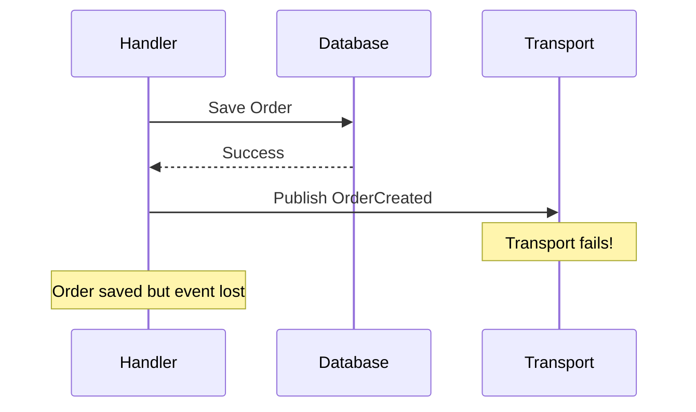
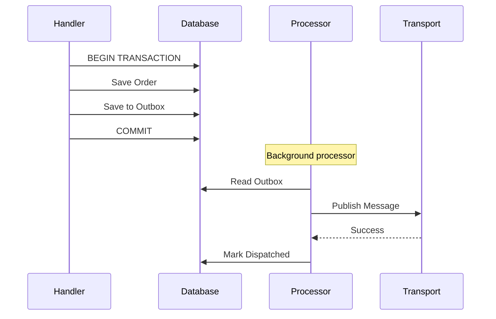
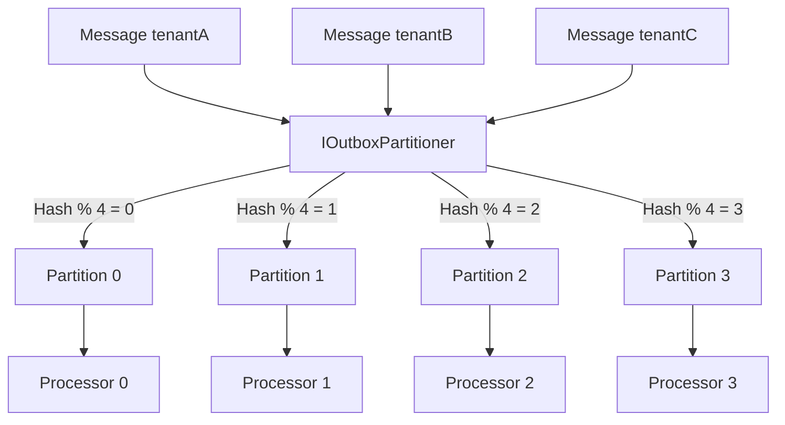

# Outbox Pattern

:::tip New to reliable messaging?

Start with the [Idempotent Consumer Guide](idempotent-consumer.md) to understand why messages get duplicated and how the Outbox and Inbox patterns work together.
:::

The outbox pattern ensures reliable message publishing by storing messages in the same database transaction as your domain changes.

:::info Delivery guarantee: at-least-once

Every staged message is delivered to its transport **at least once**. Under a dispatcher crash or a retry a message **may be delivered more than once** — the outbox is **not** exactly-once, and no configuration makes it so.

What you get is that a message cannot be *lost*: it commits with your state change, so an unreachable broker cannot cause a silent drop. What you owe in return is that **your consumers must be idempotent** — handling the same message twice must have the same effect as handling it once. The [Inbox pattern](inbox.md) provides the receive-side deduplication for this.
:::

## Before You Start

When using the optional `MessageBusOutboxPublisher`, stage an `IDispatchMessage` instance. The publisher
restores the original concrete type before sending it, preserving adapter message-kind selection and
type-based transport routing. Each transport gets a separate decoded instance. Unknown, corrupt or
mismatched payloads remain visible as failed deliveries and never become sent; other healthy rows continue.
New rows prefer a declared `[MessageName("contoso.order-placed")]` identity. Without a declaration, they
use the full type name and assembly name without the assembly version. That fallback is version-independent
for non-generic contracts; constructed generic type names can embed argument versions, so declare a stable
name on generic messages intended for durable storage. Ambiguous names are refused rather than guessed.
If a declared identity changes, retain its previous value with `[MessageNameAlias("contoso.old-order-placed")]`.
Register the current type at worker startup so old rows resolve to it. Aliases share the same registry
namespace as primary and CLR names: an alias that conflicts with another type is refused. A generic alias
shared by several closed constructions is ambiguous and cannot identify one of them.

Register durable message types at worker startup with `MessageTypeRegistry.RegisterType<T>()` from
`Excalibur.Dispatch.Delivery.Registry`. Registration during staging applies only to that process.
NativeAOT workers also need generated serialization metadata for the chosen codec; type registration alone
does not provide it. The core `OutboxProcessor` uses its own writer/serializer path and dead-letter policy.

An outbox worker composed without `AddDispatch()` must explicitly select its payload serializer.
`AddPluggableSerialization()` registers the registry and facade; it does not select a format by itself.
For a reflection-based JSON worker, use the existing registration API:

```csharp
using Excalibur.Dispatch.Serialization;

services.AddPluggableSerializer(
    SerializerIds.SystemTextJson,
    new SystemTextJsonSerializer(),
    setAsCurrent: true);
```

For NativeAOT, select a codec with generated metadata for the worker's message types instead.

- **.NET 10.0**
- Install the required packages:
  ```bash
  dotnet add package Excalibur.Dispatch.Patterns
  dotnet add package Excalibur.EventSourcing.SqlServer  # or your provider
  ```
- Familiarity with [Dispatch pipeline](../pipeline/index.md) and database transactions
- A SQL Server or PostgreSQL database for outbox storage

## Publisher tenure refusal

When `MessageBusOutboxPublisher` uses an active leader gate, it captures one fencing token for each drain
and carries that exact token through claim, completion and failure reporting. A store-reported or thrown
tenure refusal prevents later local admissions in that authority domain at that token or any older token, including scheduled,
retry and subsequent polling calls. A genuinely newer gate-authorized token can start a fresh drain.
Publishers sharing the same gate reference share the local watermark across recreation. Custom scoped
wrappers can implement `ILeaderProcessingAuthorityDomain` and return the same stable, nonnull
`AuthorityDomain` object for their underlying monotonic token sequence. Different domains remain isolated
even when numeric tokens or object equality compare equal. Do not reuse a domain for an unrelated election
or reset its token sequence while retaining that identity; the framework never disposes the domain. Row-scoped `ClaimLost`, `AlreadyTerminal` and `MessageNotFound` outcomes do not stop other claimed rows.

Check `PublishingResult.Outcome` or `IsSuccess`, rather than `FailureCount == 0` alone.
`Completed` is the existing normal-workflow outcome (including ordinary partial fanout); `TenureRefused`
means authority refused continuation, and `Interrupted` means an infrastructure fault aborted the operation.
`IsTenureRefused` is a convenience for that outcome. Both incomplete outcomes make `IsSuccess` false
without fabricating failed rows; unknown outcome values also fail closed. If both authority refusal and
infrastructure interruption occur, TenureRefused is retained and the actual errors remain visible.
A refusal is not a transport failure: `FailureCount` does not increase for unattempted rows, and
`SuccessCount` retains actual transport acceptances even when their durable completion is refused.
If the transport accepts a message and durable completion then throws, the result is `Interrupted`.
The acceptance remains in `SuccessCount`, the original error is retained, and no delivery-failure
report or retry attempt is invented. The durable commit may be unknown. New work stops for that
operation; a later operation under the same valid authority can resume.
An unrecognized durable completion outcome also interrupts only the current operation. It retains
the actual acceptance count and reports a protocol error; it does not fabricate a failed delivery
or reject the shared authority. Known row-scoped outcomes retain their continuation behavior.
A fanout message is counted once if any admitted delivery succeeds; the per-transport API instead counts
deliveries. Known unattempted remaining rows can be counted as skipped. `SuccessRate` is a row metric and
can be 100 percent while the operation is refused. Already admitted sends and fanout tasks are joined;
refusal cannot retract an external transport effect. A registry or scheduling fault after one accepted
fanout retains that partial acceptance and exact error, with Interrupted rather than reporting a complete
operation. Consumers still require idempotency.

The local admission/refusal gate orders learned refusal against later admissions; it does not make
separately sampled leader-gate properties an atomic authority snapshot. Durable safety still requires the
store's atomic fence and claim capabilities. An empty fenced claim is not evidence of refusal because
that API also returns no rows when no work is due. An active gate without a token fails closed. With no
election configured, or with an explicit `SingleActiveWriter` declaration, the existing unfenced route
remains available.

For a stale-token claim, InMemory, SQL Server, Postgres and Oracle emit an `OutboxClaimFenceRefused`
warning with the presented token and the high-water captured by that claim's atomic guard, and increment
`excalibur.outbox.fence_refusals`. Collect `Excalibur.Outbox.InMemory` (`backend=inmemory`),
`Excalibur.Outbox.SqlServer` (`backend=sqlserver`), `Excalibur.Outbox.Postgres` (`backend=postgres`) or
`Excalibur.Outbox.Oracle` (`backend=oracle`) as appropriate. The only other counter tag is
`reason=stale_claim`; IDs, tenants and token values are not metric tags. An accepted empty batch emits
neither refusal signal. InMemory reports after releasing its claim lock; SQL Server and Oracle report
after their owned commit succeeds. Postgres reports after its statement and buffered-reader cleanup
succeed, which includes implicit commit in its normal claim profile; it does not certify a caller-owned
outer transaction's commit. Metric and logger observers are independently guarded so their failures do
not turn the zero-row refusal into an exception. Each refused poll can report again. These diagnostics
do not reset a high-water, grant authority or strengthen delivery guarantees.

Multi-transport admissions share the local rejected-token watermark, but the existing per-transport
sent/failed/skipped and aggregate status methods do not expose a durable fenced claim/outcome contract.
This change does not add that capability or certify the separate `OutboxProcessor` parallel and
minimized-window paths. NativeAOT workers retain the same generated serialization metadata requirements;
the admission state introduces no reflection or dynamic-code dependency.

### Processor run authority and partial results

Each `OutboxProcessor.DispatchPendingMessagesAsync` run captures one leadership token for its claims and
completion paths. Reacquiring leadership does not give older work permission to use the newer token.
After a tenure refusal, the processor stops new transport and claim admissions and joins operations
already admitted, preserving their actual accepted-dispatch count. The returned integer does not mean
every accepted message was durably marked complete or that the queue is empty. In particular, zero
after a refused admission does not mean there was no pending work. Unattempted claims remain available
for ordinary lease recovery; they are not recorded as delivery failures.

Sequential, parallel minimized-window and at-least-once processing use the same shared authority-domain
refusal state as the publisher. Recreating a scoped processor cannot clear a refusal for the same
authority. Custom transient gate wrappers should expose one stable
`ILeaderProcessingAuthorityDomain.AuthorityDomain` identity for the underlying monotonic token sequence.
An unrelated election needs a different identity, even when its numeric fencing token is equal. A newer
authorized token can start a new drain. An already admitted operation may still settle after refusal;
this local admission ordering does not promise atomic observation of a remote lease or exactly-once
delivery. Consumers must remain idempotent.

## The Problem

Without the outbox pattern, you risk inconsistency:



## The Solution

Store messages in an outbox table within the same transaction:



## Quick Start

### Configuration

The outbox is configured through a single callback. The provider call and the processing settings
both belong inside it:

```csharp
services.AddDispatch(dispatch =>
{
    dispatch.AddHandlersFromAssembly(typeof(Program).Assembly);
});

// Configure the outbox and its store together. The provider call belongs INSIDE the
// AddOutbox callback -- that call is what registers the IOutboxStore the outbox drains
// and the one your own types inject.
services.AddExcalibur(excalibur => excalibur.AddOutbox(outbox =>
{
    outbox.UseSqlServer(sql => sql
        .ConnectionString(connectionString)
        .SchemaName("outbox"));
}));
```

### Processing settings

Processing is configured with `WithProcessing`, and background draining is turned on with
`EnableBackgroundProcessing`. Both hang off the same `AddOutbox` callback as the provider call:

```csharp
services.AddExcalibur(excalibur => excalibur.AddOutbox(outbox => outbox
    .UseSqlServer(sql => sql
        .ConnectionString(connectionString)
        .SchemaName("outbox"))
    .WithProcessing(processing => processing
        .BatchSize(1000)
        .PollingInterval(TimeSpan.FromMilliseconds(100))
        .MaxRetryCount(3)
        .RetryDelay(TimeSpan.FromMinutes(1))
        .ProcessorId("worker-1")
        .EnableParallelProcessing(maxDegreeOfParallelism: 8))
    .EnableBackgroundProcessing()));
```

`EnableParallelProcessing` takes the degree of parallelism directly and defaults to `4`. A degree of
`1` is valid and processes sequentially; leaving it off also retains the sequential processor default.

`BatchSize` supplies producer and consumer batch defaults. `MaxRetryCount` counts retries after the
initial attempt, so three retries means four total attempts and zero retries means one. `RetryDelay`
supplies the processor's default fixed backoff calculator. A registered `IBackoffCalculator`, including
the Polly adapter, overrides it. Backoff-capable providers persist the later of the requested retry time
and their own failure floor; an earlier request cannot weaken that floor.

Explicit `Configure` and `PostConfigure` callbacks for `OutboxDeliveryOptions` or
`OutboxProcessingOptions` override builder defaults in either registration order. The immutable
`OutboxOptions` reports builder defaults; inspect the resolved delivery/background options for effective
settings. `int.MaxValue` retries plus the initial attempt cannot fit in the total-attempt field: choose
fewer retries or explicitly configure a positive `OutboxDeliveryOptions.MaxAttempts` total. A custom
publisher can own a separate policy without consuming the default processor's delivery options.

### Suggested profiles

These are starting points, not a mechanism -- each is just the set of `WithProcessing` values below,
which you type out for the profile you want. There is no preset argument to pass.

| Setting | Larger parallel batch | Moderate parallel batch | Sequential batch |
|---------|-----------------|----------|------------------|
| `BatchSize` | 1000 | 100 | 10 |
| `PollingInterval` | 100ms | 1s | 5s |
| `MaxRetryCount` | 3 | 5 | 10 |
| `RetryDelay` | 1 min | 5 min | 15 min |
| `EnableParallelProcessing` | 8 | 4 | omit (sequential) |

| Profile | Use case |
|---------|----------|
| **Larger parallel batch** | Evaluate resource use and ordering constraints |
| **Moderate parallel batch** | Evaluate completed throughput |
| **Sequential batch** | Evaluate sequential processing and retry requirements |

Moderate parallel batch, spelled out:

```csharp
services.AddExcalibur(excalibur => excalibur.AddOutbox(outbox => outbox
    .UseSqlServer(sql => sql.ConnectionString(connectionString))
    .WithProcessing(processing => processing
        .BatchSize(100)
        .PollingInterval(TimeSpan.FromSeconds(1))
        .MaxRetryCount(5)
        .RetryDelay(TimeSpan.FromMinutes(5))
        .EnableParallelProcessing(maxDegreeOfParallelism: 4))
    .EnableBackgroundProcessing()));
```

Sequential batch -- small batches and longer backoff; not a reliability guarantee:

```csharp
services.AddExcalibur(excalibur => excalibur.AddOutbox(outbox => outbox
    .UseSqlServer(sql => sql.ConnectionString(connectionString))
    .WithProcessing(processing => processing
        .BatchSize(10)
        .PollingInterval(TimeSpan.FromSeconds(5))
        .MaxRetryCount(10)
        .RetryDelay(TimeSpan.FromMinutes(15)))
    .EnableBackgroundProcessing()));
```

### Usage in Handlers

Inject `IOutboxWriter` into your handler and call `WriteAsync` to stage outbound messages.
Verify the actual staging path and transaction participation; `ConsistencyMode` alone does not
make a separate business write atomic with staging:

```csharp ignore
using Excalibur.Dispatch.Outbox;

public class CreateOrderHandler : IDispatchHandler<CreateOrderAction>
{
    private readonly IDbConnection _db;
    private readonly IOutboxWriter _outboxWriter;

    public CreateOrderHandler(IDbConnection db, IOutboxWriter outboxWriter)
    {
        _db = db;
        _outboxWriter = outboxWriter;
    }

    public async Task<IMessageResult> HandleAsync(
        CreateOrderAction action,
        IMessageContext context,
        CancellationToken ct)
    {
        using var transaction = _db.BeginTransaction();
        context.SetItem("Transaction", transaction);

        // Save domain changes
        var orderId = Guid.NewGuid();
        await _db.ExecuteAsync(
            "INSERT INTO Orders (Id, CustomerId) VALUES (@Id, @CustomerId)",
            new { Id = orderId, action.CustomerId },
            transaction);

        // Stage outbound work; verify transaction participation separately.
        await _outboxWriter.WriteAsync(
            new OrderCreatedEvent(orderId, action.CustomerId),
            destination: "orders",
            ct);

        transaction.Commit();
        return MessageResult.Success();
    }
}
```

For scheduled delivery, use the `WriteScheduledAsync` extension method:

```csharp
await _outboxWriter.WriteScheduledAsync(
    new ReminderEvent(orderId),
    destination: "reminders",
    scheduledAt: DateTimeOffset.UtcNow.AddHours(24),
    ct);
```

### Consistency Modes

Configure the outbox consistency mode via `OutboxStagingOptions`:

```csharp
services.AddDispatch(dispatch =>
{
    dispatch.UseOutbox(outbox =>
    {
        // Default: startup requires an IOutboxStore, because UseOutbox() states that this host
        // stages. It adds no requirement on the transaction middleware.
        outbox.ConsistencyMode = OutboxConsistencyMode.EventuallyConsistent;

        // OR: additionally refuse to start unless the transaction middleware is registered too.
        outbox.ConsistencyMode = OutboxConsistencyMode.Transactional;
    });
});
```

:::caution ConsistencyMode is a startup requirement, not a write-path selector

Calling `UseOutbox()` at all makes startup **fail** unless an `IOutboxStore` is registered — the call is
how you state that this host stages, so a missing store is a misconfiguration rather than a host without
an outbox. Setting `ConsistencyMode` to `Transactional` adds the transaction middleware to that
requirement. Neither setting chooses how writes are staged, and a configuration that starts successfully
is not thereby transactional.

For event-sourced aggregates the write path is selected by the **staging strategy on the event-sourcing
builder**, which prefers the transactional path only when a transactional outbox writer *and* an event
store that supports transactional staging are both present, and falls back to the eventually-consistent
path otherwise. That check lives in the event-sourcing packages, so `ConsistencyMode` cannot perform it —
it can only refuse to start without the parts the dispatch side can see.

If you need transactional staging, configure the staging strategy where your aggregates are registered and
verify the path your store actually takes; `ConsistencyMode` alone will not give it to you.

:::

| Mode | Dispatch-side startup requirement | Write-path guarantee |
|------|----------------------------------|----------------------|
| **EventuallyConsistent** (default) | `UseOutbox()` requires an `IOutboxStore`; no additional transaction-middleware requirement | Does not select or prove atomic staging |
| **Transactional** | Requires `IOutboxStore` registration and transaction middleware | Does not select or prove atomic staging; participating writes must share a supported transaction |

Atomic staging does not eliminate duplicate delivery. Verify the actual staging strategy and
transaction participation, and keep consumers idempotent.


## Outbox Stores

### SQL Server

```csharp
using System;
using System.Threading;
using System.Threading.Tasks;
using Excalibur.Dispatch;
using Microsoft.Extensions.DependencyInjection;

public static class SqlOutboxRegistration
{
    public static void Run(IServiceCollection services, string connectionString)
    {
        services.AddSqlServerOutboxStore(options =>
        {
            options.ConnectionString = connectionString;
            options.Tables.SchemaName = "outbox";
            options.Tables.OutboxTableName = "OutboxMessages";
        });
    }
}
```

With fluent SQL Server registration, `sql.BindConfiguration("Outbox:SqlServer")` binds
`SqlServerOutboxOptions`, including its `Tables` and `Processing` sections, using generated
configuration binding. Connection modes are mutually exclusive: the last call to select
`ConnectionString`, `ConnectionStringName`, `ConnectionFactory` or `BindConfiguration` wins.
Configuration reload updates `IOptionsMonitor<SqlServerOutboxOptions>`; it does not reconnect
an already constructed outbox store. Configure the store before starting workers.

### PostgreSQL

```csharp
services.AddExcalibur(excalibur => excalibur.AddOutbox(outbox =>
{
    outbox.UsePostgres(postgres =>
    {
        postgres.ConnectionString(connectionString)
                .SchemaName("outbox")
                .TableName("outbox_messages");
    });
}));
```

### Redis

```csharp
services.AddExcalibur(excalibur => excalibur.AddOutbox(outbox =>
{
    outbox.UseRedis(redis =>
    {
        redis.ConnectionString("localhost:6379")
             .KeyPrefix("outbox:");
    });
}));

// Or with an existing ConnectionMultiplexer from DI
services.AddExcalibur(excalibur => excalibur.AddOutbox(outbox =>
{
    outbox.UseRedis(redis =>
    {
        redis.Multiplexer(existingMultiplexer)
             .KeyPrefix("outbox:");
    });
}));
```

### MongoDB

```csharp
services.AddExcalibur(excalibur => excalibur.AddOutbox(outbox =>
{
    outbox.UseMongoDB(mongo =>
    {
        mongo.ConnectionString(connectionString)
             .DatabaseName("myapp");
    });
}));
```

MongoDB requires a dedicated ordinary outbox collection with **simple (binary) collation** and its
simple unique `_id` index. Both constructors inspect the effective namespace before provider row actions
or automatic index creation. An absent collection is explicitly created with simple collation; an
incompatible existing collection is rejected without rewriting rows or indexes. Language-aware collation
can equate distinct message IDs or acquisition receipts; adding a secondary index does not repair that
identity namespace. Grant metadata-inspection permissions as well as normal data permissions. Migrate an
incompatible collection only through a separately planned procedure with producers/workers quiesced;
do not replace the namespace under an initialized live store. Other application collections can retain
their own collation. See [Polling provider capabilities](#polling-provider-capabilities).

### Elasticsearch

```csharp
services.AddExcalibur(excalibur => excalibur.AddOutbox(outbox =>
{
    outbox.UseElasticSearch(options =>
    {
        options.IndexName = "excalibur-outbox";
        options.DefaultBatchSize = 100;
    });
}));
```

### Firestore

```csharp
services.AddExcalibur(excalibur => excalibur.AddOutbox(outbox =>
{
    outbox.UseFirestore(options =>
    {
        options.ProjectId = "my-gcp-project";
        options.CollectionName = "outbox";
    });
}));
```

### Cosmos DB

```csharp
services.AddExcalibur(excalibur => excalibur.AddOutbox(outbox =>
{
    outbox.UseCosmosDb(cosmos =>
    {
        cosmos.ConnectionString(connectionString)
              .DatabaseName("myapp")
              .ContainerName("outbox");
    });
}));
```

### DynamoDB

```csharp
services.AddExcalibur(excalibur => excalibur.AddOutbox(outbox =>
{
    outbox.UseDynamoDb(options =>
    {
        options.Connection.Region = "us-east-1";
        options.TableName = "outbox";
    });
}));
```

## Database Schema

The `MessageType` column holds the event's declared `[MessageName]` — the same stable name the event
store records and external subscribers see as the CloudEvents `type`. It is what your consumers route
on, and it does not change when the CLR type moves. See
[stable message names](../event-sourcing/domain-events.md#stable-message-names).

### SQL Server

The SQL Server store does **not** auto-create tables — create the schema before starting the application. The `IX_OutboxMessages_Claim` index supports the claim predicate and eligible-row selection; it does not establish ordered delivery completion.

`Excalibur.Outbox.SqlServer` packs its DDL as numbered scripts under `scripts/` in the NuGet package.
Those files are the authority for this schema — the store's own statements are derived from them.

| Script | What it does |
|--------|--------------|
| `001_CreateOutboxSchema.sql` | Creates `OutboxMessages`, `OutboxMessageTransports`, `DeadLetterQueue` and `OutboxFence`. Also carries a guarded additive step that converges a legacy table whose `TenantId` is still nullable. |

```bash
# The scripts sit alongside lib/ in the package folder your restore populated.
ls ~/.nuget/packages/excalibur.outbox.sqlserver/<version>/scripts/
```

:::caution Provision from the scripts, not from a transcription of them
This page used to restate these `CREATE TABLE` statements inline. A restatement drifts from the store
silently and carries no upgrade path; the packaged scripts are the single copy kept in step with the
code, and the only copy that is numbered. Provision from them rather than from any restatement.
:::

:::caution A database provisioned by an earlier prerelease

`TenantId` is declared `NVARCHAR(64)`, and a create script skips any table that already exists, so a
database provisioned by an earlier prerelease keeps whatever width it was given. There is no in-place
upgrade path — re-provision it from the script above. Two tenant identifiers that differ only after
the 64th character are distinct in a wider column and identical in this one, and `TenantId` is part
of the dead-letter primary key.
:::

:::note Ordering and retry-backoff columns
`PartitionKey` / `GroupKey` / `SequenceNumber` persist the message ordering keys, and `NextAttemptAt` records the per-message backoff deadline. The background processor claims rows with `WHERE Status IN (Staged, Failed, PartiallyFailed) AND (NextAttemptAt IS NULL OR NextAttemptAt <= @now) ORDER BY PartitionKey, SequenceNumber` — so same-partition messages are delivered in ascending `SequenceNumber`, and a failed message's computed backoff genuinely throttles re-delivery. See [Ordering and Retry Scheduling](#ordering-and-retry-scheduling).
:::

If you use **multi-transport delivery** (`IsMultiTransport` / per-transport tracking) or the **dead-letter queue**, create those tables too — the store does not auto-create them either:

Both are created by the same `001_CreateOutboxSchema.sql` — there is no separate script to run.

#### Upgrading an existing outbox table

If your `OutboxMessages` table was created while `TenantId` was nullable, tighten it before deploying.
A nullable tenant lets an un-tenanted row exist, and no tenant-scoped read can ever match it — the row
becomes unreachable rather than shared. Existing `NULL`s are backfilled to the reserved untenanted
value first, so the change preserves every row and cannot fail on legacy data:

Run `001_CreateOutboxSchema.sql`. Its tightening step is additive and guarded on
`is_nullable`, so it converges a legacy table and does nothing to an already-correct one.

Run this before starting the upgraded application. The framework never writes `NULL` — a message staged
with no tenant in scope carries the reserved `__untenanted__` value — so the backfill and the application
agree on what an untenanted row looks like.

:::caution Do not test a drained message for a null tenant

A message you stage with `TenantId = null` is drained carrying the reserved `__untenanted__` value, on
**every** store — the document and key-value providers as well as the relational ones. Untenanted is a
value, not an absence, so a handler written as:

```csharp
if (message.TenantId is null) { /* untenanted */ }   // never true after a drain
```

silently never takes that branch. Compare against the reserved value, or fold through the framework's
total conversion, which accepts every spelling:

```csharp
var partition = KeyedTenantPartition.FromStoredValue(message.TenantId);
if (partition.Equals(KeyedTenantPartition.Untenanted)) { /* untenanted */ }
```

If you implement your own outbox store, the published `OutboxStoreConformanceTestKit` enforces this: its
`UntenantedPartition_MustRoundTripItsOwnMessage` arm fails a store that hands back a null as well as one
that invents a tenant.

:::

### PostgreSQL

The PostgreSQL store does **not** auto-create tables — create the schema before starting the application. The `tenant_id` column persists tenant isolation and the `destination` column persists the delivery target, both through enqueue → reserve → dispatch; staged messages fail with `column "tenant_id" does not exist` or `column "destination" does not exist` if either is missing.

```sql
-- Object names follow the PostgresOutboxStoreOptions defaults (SchemaName "public",
-- OutboxTableName "outbox", DeadLetterTableName "outbox_dead_letters"). If you override any of
-- them, rename the corresponding object here to match.
CREATE TABLE IF NOT EXISTS public.outbox (
    -- The message id IS the primary key. Every read, claim, delete and dead-letter path
    -- addresses a row by it, and no query selects a surrogate, so there is no id column.
    message_id          VARCHAR(100)  NOT NULL PRIMARY KEY,
    message_type        VARCHAR(500)  NOT NULL,
    message_metadata    TEXT,
    message_body        BYTEA         NOT NULL,
    -- Every row carries a tenant term; "no tenant" is the reserved '__untenanted__' value rather
    -- than the absence of one, so a scoped predicate and an unscoped one compare the same kind of
    -- thing. The staging path binds the term explicitly, so the DEFAULT is a backstop for
    -- hand-written INSERTs rather than something the store relies on.
    tenant_id           VARCHAR(64)   NOT NULL DEFAULT '__untenanted__',
    destination         VARCHAR(500),
    correlation_id      VARCHAR(255),
    causation_id        VARCHAR(255),
    priority            INT           NOT NULL DEFAULT 0,
    scheduled_at        TIMESTAMPTZ,
    partition_key       VARCHAR(255),
    group_key           VARCHAR(255),
    sequence_number     BIGINT        NOT NULL DEFAULT 0,
    target_transports   VARCHAR(500),
    is_multi_transport  BOOLEAN       NOT NULL DEFAULT FALSE,
    -- The caller's created-at, not the server clock: the staging path binds it explicitly so the
    -- value survives the stage-then-reload round trip.
    occurred_on         TIMESTAMPTZ   NOT NULL DEFAULT NOW(),
    attempts            INT           NOT NULL DEFAULT 0,
    error_message       TEXT,
    -- The claim token written by a drain that has reserved the row, and the instant that
    -- reservation lapses. Together they form the reservation lease.
    dispatcher_id       VARCHAR(100),
    dispatcher_timeout  TIMESTAMPTZ,
    -- The failure-anchored visibility floor. A message reported failed below the retry ceiling is
    -- deferred until this instant, so a failure cannot hot-loop the drain.
    next_attempt_at     TIMESTAMPTZ
);

-- All four timestamp columns are TIMESTAMPTZ, not TIMESTAMP. The store binds them as true
-- timestamptz values; a column created WITHOUT time zone is silently shifted by the session
-- timezone on reload, so a scheduled message becomes due at the wrong instant.

-- Supports the claim cursor's ordering. The drain selects eligible rows ordered by partition_key,
-- sequence_number, occurred_on. Ordered selection does not guarantee completion order across
-- concurrent drains or retries. Validate index changes against the actual claim predicate.
CREATE INDEX IF NOT EXISTS ix_outbox_claim_order ON public.outbox (partition_key, sequence_number, occurred_on);

-- Supports releasing a reservation by dispatcher, which matches on dispatcher_id alone.
CREATE INDEX IF NOT EXISTS ix_outbox_dispatcher ON public.outbox (dispatcher_id);

-- Supports the scheduled-message sweep, which selects rows whose scheduled_at has come due.
CREATE INDEX IF NOT EXISTS ix_outbox_scheduled_at ON public.outbox (scheduled_at);

-- The move into this table DELETEs the outbox row, so this is the ONLY remaining record of the
-- message. Anything the move does not copy is destroyed, not merely unindexed.
CREATE TABLE IF NOT EXISTS public.outbox_dead_letters (
    message_id          VARCHAR(100)  NOT NULL,
    -- Originating tenant, carried as provenance so a replay re-enters the SAME tenant. NOT NULL and
    -- a component of the primary key. No DEFAULT, deliberately -- and this is the one place it
    -- differs from the outbox table. The move always copies the value from the outbox row, whose
    -- own column is total, so the value is always supplied. A default here would let a
    -- hand-written INSERT that forgot the column record a message as untenanted when its tenant was
    -- simply never named. Without one, that INSERT fails loudly.
    tenant_id           VARCHAR(64)   NOT NULL,
    message_type        VARCHAR(500)  NOT NULL,
    message_metadata    TEXT,
    message_body        BYTEA         NOT NULL,
    occurred_on         TIMESTAMPTZ   NOT NULL DEFAULT NOW(),
    attempts            INT           NOT NULL DEFAULT 0,
    error_message       TEXT,
    moved_on            TIMESTAMPTZ   NOT NULL DEFAULT NOW(),
    -- Composite on purpose, and NOT a pattern to copy onto the outbox table. The outbox is drained
    -- by a claim-then-mark protocol that addresses a row by its id alone, so widening that key
    -- there is a correctness defect. Nothing addresses a dead letter by id: the read path pages by
    -- age and attempts, and the statistics path counts.
    CONSTRAINT pk_outbox_dead_letters PRIMARY KEY (message_id, tenant_id)
);

-- Supports the dead-letter read path, which pages by occurred_on ascending.
CREATE INDEX IF NOT EXISTS ix_outbox_dead_letters_occurred_on ON public.outbox_dead_letters (occurred_on);
```

:::tip Run the shipped script instead
`Excalibur.Outbox.Postgres/Scripts/001_CreateOutboxSchema.sql` is the authority for this schema and
is reproduced above. It is packed inside the NuGet package under `scripts/`.

**It provisions and it upgrades.** The table and index statements are `CREATE ... IF NOT EXISTS`, so
they do nothing against objects that already exist; the script then runs a guarded
`ALTER TABLE ... ADD COLUMN IF NOT EXISTS` for every outbox column, so a table created by an earlier
revision gains whichever columns it is missing. Run the packaged script rather than hand-writing the
DDL.

Two columns are deliberately left out of the additive step. `message_type` and `message_body` are
`NOT NULL` with no default, so adding them to a table that already has rows would fail outright, and
both have existed since this table's first revision — a table missing either is not an earlier outbox
but a name collision with something else, and failing loudly is the right outcome.

If your table was created from an earlier revision of this page it has a `SERIAL` `id` column and a
`UNIQUE` constraint on `message_id` instead of a primary key on it. That shape still works -- the
store addresses rows by `message_id`, which is unique either way -- but the surrogate key is never
read. A `tenant_id` declared `VARCHAR(255)` is also wider than the store will ever write. A database
provisioned by an earlier prerelease has no in-place upgrade path onto the current shape;
re-provision it from the packaged script.
:::

:::note Leader-elected (fenced) deployments need a fence control table
If you run the Postgres outbox **single-active across instances** (a leader-elected processor passing a fencing token), also create the fence control table. It holds one monotonic high-water mark per scope so a demoted leader's stale-token drain/mark is rejected — the guard that prevents a demoted leader from double-delivering (delivery remains at-least-once; this closes the split-brain window, it does not make it exactly-once). It is **not** needed for a single-instance outbox.

```sql
CREATE TABLE IF NOT EXISTS public.outbox_fence (
    scope_key           VARCHAR(600)  NOT NULL PRIMARY KEY,
    high_water_token    BIGINT        NOT NULL
);
```

The table name defaults to `outbox_fence` (override via `PostgresOutboxStoreOptions.FenceTableName`, qualified by `SchemaName`). The Oracle store uses an equivalent control table named via `OracleOutboxStoreOptions.FenceTableName`.

**The SQL Server outbox uses a durable `OutboxFence` control table.** Like every other table this store uses, it is **not** created at runtime — the store auto-creates nothing. The packaged schema script (`001_CreateOutboxSchema.sql`, shipped inside the NuGet package) creates it for you if you run that script; if you instead copy the DDL from the SQL Server schema section above, `OutboxFence` is included in that block and you must create it along with the others. It is required even for a single-instance deployment that never uses fencing, because the drain references it unconditionally and SQL Server binds object names before the runtime predicate can short-circuit. It holds one monotonic high-water mark per scope that outbox cleanup never touches, so a demoted leader's stale-token drain/mark is rejected even after the outbox has been cleaned up or drained empty. The table name defaults to `OutboxFence` (override via `SqlServerOutboxOptions.Tables.FenceTableName`, qualified by `Tables.SchemaName`). See [Multi-Instance (Leader-Fenced) Processing](#multi-instance-leader-fenced-processing).
:::

:::note A database provisioned by an earlier prerelease
There is no in-place upgrade path onto the current shape; re-provision from the packaged
`001_CreateOutboxSchema.sql`. `tenant_id` arrives `NOT NULL DEFAULT '__untenanted__'`, so an
untenanted message is stored as a value rather than as the absence of one — which is what lets a
tenant predicate compare like with like.

If you run a leader-elected (fenced) outbox, add the `outbox_fence` control table shown above as well.
:::

:::caution A dead-letter table provisioned by an earlier prerelease cannot be carried forward
`outbox_dead_letters` carries the producing tenant, and the move that fills it deletes the outbox row
it copied from — so for an entry already sitting in a table that predates the tenant column, the
tenant that produced it exists nowhere the store can reach. There is no in-place upgrade path that
could recover it. Re-provision from the packaged `001_CreateOutboxSchema.sql`, and do not redrive an
entry carried over by hand: stamping it untenanted records "no tenant was captured" rather than
evidence the message was untenanted, and a message that really belonged to a tenant would re-enter
the wrong one.

If those entries matter to you, drain, redrive, or export them **before** upgrading, while their
tenant is still implied by your own operational records.
:::

## Background Processing

### Hosted Service (Recommended)

```csharp
services.AddExcalibur(excalibur => excalibur.AddOutbox(outbox =>
{
    outbox.UseSqlServer(sql => sql.ConnectionString(connectionString))
          // The processor has no dead-letter default -- see Dead Letter Handling below. A durable queue
          // keeps exhausted messages for inspection and replay; registering
          // NullDeadLetterQueue.Instance instead chooses discard deliberately.
          .WithSqlServerDeadLetterQueue(dlq => dlq.ConnectionString = connectionString)
          .EnableBackgroundProcessing();
}));
```

`EnableBackgroundProcessing()` registers the outbox background service for you. If you prefer to
register it as a separate step, `services.AddOutboxHostedService()` registers the same service.

:::info The drain is opt-in — it is not registered unless you ask for it
Neither the background service nor any other drain is registered by `AddOutbox(...)` alone. A host that
calls neither `EnableBackgroundProcessing()` nor `AddOutboxHostedService()` will stage messages and
publish nothing, which is a valid topology if you drain from a separate worker process or by triggering
`IOutboxProcessor` yourself — and a silent mistake if you did not intend it. The
`EnableBackgroundProcessing` option reports the builder opt-in.

Both opt-ins also require an explicit dead-letter decision — there is no default, so that no deployment
can silently discard a message whose delivery was exhausted. Register a durable queue or explicitly
register `NullDeadLetterQueue.Instance`; see [Dead Letter Handling](#dead-letter-handling).

Both opt-ins use the registered `IOutboxProcessor` unless you supply a custom `IOutboxPublisher`.
Configure Dispatch and an outbox store before starting the host. See
[Publisher Configuration](#publisher-configuration) below for the default processing path and custom extension point.
:::

### Quartz Job (Scheduled Processing)

For enterprise scheduling needs, use `OutboxProcessorJob` from `Excalibur.Jobs`:

```csharp
// Install: dotnet add package Excalibur.Jobs

services.AddExcalibur(excalibur => excalibur.AddOutbox(outbox =>
    outbox.UseSqlServer(sql => sql.ConnectionString(connectionString))));

// Register the Quartz.NET outbox processor job
// Configure schedule in appsettings.json or via Quartz API
```

The `OutboxProcessorJob` integrates with Quartz.NET for scheduled outbox processing with built-in health checks and multi-database support.

### Manual Processing

For serverless environments (Azure Functions, AWS Lambda):

```csharp
// Serverless: leave EnableBackgroundProcessing() off so no polling loop is registered,
// and drive the processor from the platform's own trigger instead.
services.AddExcalibur(excalibur => excalibur.AddOutbox(outbox =>
{
    outbox.UseSqlServer(sql => sql.ConnectionString(connectionString))
          .WithProcessing(processing => processing
              .BatchSize(50)
              .MaxRetryCount(3));
}));

// Process manually (e.g., Azure Function timer trigger)
public class OutboxProcessorFunction
{
    private readonly IOutboxProcessor _processor;

    [Function("ProcessOutbox")]
    public async Task Run([TimerTrigger("*/5 * * * * *")] TimerInfo timer)
    {
        await _processor.DispatchPendingMessagesAsync(CancellationToken.None);
    }
}
```

### Multi-Instance (Leader-Fenced) Processing

When more than one instance can drain the same outbox, register an `ILeaderElection` provider. Doing so
makes the outbox drain **single-active (leader-fenced) by default** — only the elected leader drains, and
every claim/mark carries a **monotonic fencing token**, checked against the store's recorded fencing
high-water mark, so a superseded leader's claim or mark is rejected.

**PostgreSQL, Oracle, and SQL Server record the high-water mark in a dedicated fence control
table that outbox cleanup never touches**, so the rejection survives cleanup — closing the split-brain
window that would otherwise double-deliver under a leader handover. (Delivery is at-least-once either way; this removes a specific split-brain duplicate source.) SQL Server's `OutboxFence` table is
advanced by a single serializable `MERGE` (a compare-and-advance under `HOLDLOCK`) that raises the mark
monotonically and never lowers it, so a superseded leader's stale token is rejected fail-closed even
after a cleanup has purged the sent, token-bearing rows. The per-message lease independently prevents two
processors from claiming or completing the *same* message.

```csharp
services.AddExcalibur(exc => exc
    .AddOutbox(outbox => outbox.UsePostgres(pg => pg.ConnectionString(connectionString)))
    // Registering a leader election is the multi-instance signal — the outbox drain is fenced automatically.
    .AddLeaderElection(le => le.UseSqlServer(sql => sql
        .ConnectionString(leaderConnectionString)
        .LockResource("MyApp.Outbox"))));
```

Registering leader election is the multi-instance signal, so **no extra opt-in is required** to fence the
drain. (For a fencing-capable store you can still call `outbox.WithLeaderElection()` explicitly; it
composes idempotently with the automatic wiring.)

**Fail-fast on a store that cannot fence.** If a leader election is registered and the configured store
does not expose the required fenced acquisition/completion capabilities through `GetService`, the
processor **refuses to start** with an `InvalidOperationException`. Fencing-capable polling stores are
**SQL Server, PostgreSQL, Oracle with an owned worker connection source, and in-memory**. In-memory
high-water state does not survive process loss. Redis, MongoDB, Elasticsearch and Marten do not advertise
this fenced route. A genuine single-drainer deployment can use the explicit topology assertion below;
that assertion does not manufacture durable fencing or missing claim/dead-letter capabilities.

**Fail-fast on an ungated drain.** The check above keys on the presence of the **leader election**, not on
the presence of the gate that fences the drain — a guard that keyed on the gate could not detect the case it
exists to detect, because a host with no gate would simply read as single-instance. So if a leader election
is resolvable and nothing fences the drain, startup **refuses** with an `InvalidOperationException` naming
both remedies, rather than letting every instance drain concurrently. You will normally never see this: the
first-party registration paths wire the gate for you. It fires when an election reaches the container by some
other route — a hand-registered `ILeaderElection`, or a provider from outside the framework. Wire the gate
with `outbox.WithLeaderElection()`, or declare a genuine single-drainer topology with `AsSingleWriter()`.

**Opting out — single-active-writer topology.** If exactly one process drains the outbox even though a
leader election is registered for *other* resources (leases, scheduled jobs), assert that topology
explicitly with `AsSingleWriter()`:

```csharp
services.AddExcalibur(exc => exc
    .AddOutbox(outbox => outbox
        .UseElasticSearch(es => es.NodeUri("http://localhost:9200"))
        .AsSingleWriter())   // Asserts a single-active-drainer topology and opts out of fencing.
                         // Delivery is still at-least-once; consumers must be idempotent.
    .AddLeaderElection(le => le.UseSqlServer(sql => sql
        .ConnectionString(leaderConnectionString)
        .LockResource("MyApp.Leader"))));
```

`AsSingleWriter()` runs the drain **unfenced** and is deliberately **observable**: the outbox logs a
startup **warning** (`OutboxUnfencedBySingleWriterOptOut`). Enable it only for a genuine
single-active-writer deployment — using it in a multi-writer deployment reopens the split-brain window
fencing exists to close. When no leader election is registered, draining is unfenced and emits a
one-time startup **info** log (`OutboxRunningUnfenced`). Absence of election does not enforce a
single-process deployment.

## Publisher Configuration

### Framework Processor

Background processing uses the registered `IOutboxProcessor` when no custom `IOutboxPublisher` is supplied. The processor deserializes registered messages and dispatches them through `IDispatcher`, retaining failed work for the configured retry policy.

```csharp
services.AddDispatch(dispatch =>
{
    dispatch.AddHandlersFromAssembly(typeof(Program).Assembly);
    dispatch.UseOutbox();
});

services.AddExcalibur(excalibur => excalibur.AddOutbox(outbox =>
    outbox.UseSqlServer(sql => sql.ConnectionString(connectionString))
          .EnableBackgroundProcessing()));
```

Inject `IOutboxWriter` into a handler to buffer outbound events. Staging runs after a successful downstream result. This eventually consistent path does not make a separate business database write atomic with staging. For broker delivery, configure the Dispatch transport and event routing and verify the intended destination.

### Custom Publisher

A registered `IOutboxPublisher` takes precedence over the processor fallback. This is an optional extension point for applications that need a different publication strategy. A custom implementation must implement the complete interface and preserve its delivery contract:

- Claim eligible rows before publishing and honor the store's claim ownership and fencing capabilities.
- Respect scheduled eligibility, retry backoff and attempt accounting.
- Mark a row sent only after the destination accepts delivery; an unsuccessful HTTP response is not acceptance.
- Dispose transport responses and request content, and propagate caller cancellation.
- Retain recoverable failures without claiming atomic or exactly-once delivery across a remote HTTP operation.

Prefer the framework processor and supported transports when they meet the application's needs. A custom publisher must be verified against the actual destination and store before enabling its hosted drain.
## Error Handling

### Retry Configuration

```csharp
// Aggressive retries: 10 retries after the initial attempt, 15 minutes apart.
services.AddExcalibur(excalibur => excalibur.AddOutbox(outbox =>
{
    outbox.UseSqlServer(sql => sql.ConnectionString(connectionString))
          .WithProcessing(processing => processing
              .MaxRetryCount(10)
              .RetryDelay(TimeSpan.FromMinutes(15)));
}));

// Or a lighter policy: 7 retries after the initial attempt, 2 minutes apart.
services.AddExcalibur(excalibur => excalibur.AddOutbox(outbox =>
{
    outbox.UseSqlServer(sql => sql.ConnectionString(connectionString))
          .WithProcessing(processing => processing
              .MaxRetryCount(7)
              .RetryDelay(TimeSpan.FromMinutes(2)));
}));
```

Each persisted attempt owns nested framework retries for the same message and context, so enabling
retry middleware does not multiply the durable attempt budget. Different nested dispatch identities
retain their own policies. Caller cancellation observed before failure accounting propagates without charging a new delivery failure;
an independent provider timeout with an uncancelled caller remains a failure. SDK retry policies are
separate. Broker acceptance followed by a failed completion write can still lead to redelivery.

### Dead Letter Handling

The default outbox processor requires an explicitly registered `IDeadLetterQueue` before
processing begins. Register a recovery queue separately from the outbox store; registering
the store alone does not supply one. A queue can be registered after `AddOutbox` as long as
it exists when the default processor is resolved. Store-only staging and consumer-provided
processors do not acquire this default processor requirement.

```csharp
services.AddSqlServerOutboxStore(options => options.ConnectionString = connectionString);

// The dead-letter table is configured on the dead-letter queue itself, not on the
// outbox store. Its default table is DeadLetterQueue, which is the table the
// packaged schema script creates.
services.AddSqlServerDeadLetterQueue(opts =>
{
    opts.ConnectionString = connectionString;
    opts.TableName = "DeadLetterQueue";
});
```

Apply the provider's packaged schema before use. This registration retains entries for
inspection; automatic replay requires a separately configured replay handler. See
[Dead Letter Queue](dead-letter.md) for replay readiness and tenant scope.

To intentionally discard terminal failures, explicitly register
`NullDeadLetterQueue.Instance` as `IDeadLetterQueue`. The processor logs this choice and
reports terminal messages as discarded. It never supplies that choice implicitly. A
nonnull queue alone does not establish durable storage or atomic transfer between the
queue and outbox; verify the selected provider and recovery path.

### Exhausted delivery during a dead-letter outage

The facade's `MaxRetryCount` excludes the initial attempt. Its delivery-option mapping adds the
initial attempt to obtain `MaxAttempts`; explicit delivery-option overrides require separate review.
If dead-letter disposition fails, the polling processor records the observed count and
pending disposition with the original claim authority. A recovered claim retries disposition
before decoding or sending, so a queue outage does not reset an already exhausted budget.
Permanent and poison failures likewise retain their pending disposition. A preparation
failure performs no transport send and can have an attempt count of zero.

Retirement stores preserve the greater of the persisted and supplied attempt counts. They
do not add an attempt for moving a row to an archive. Cancellation and circuit-open admission
do not charge a delivery attempt. Failed or ambiguous bookkeeping can still cause redelivery;
these counts are not a crash-proof limit on physical SDK requests. Keep consumers idempotent
and monitor both delivery failures and disposition failures.

## Ordering and Retry Scheduling

### Claim Selection Order

Outbound messages carry `PartitionKey`, `GroupKey`, and `SequenceNumber`. Verify eligible-row
selection behavior for the chosen provider. Ordering eligible rows for a claim does not guarantee
delivery or completion order: parallel processing, retries and multiple drainers can reorder effects.
An earlier row may be temporarily ineligible for retry while a later row proceeds. `GroupKey` is an
independent logical grouping label; it does not itself establish an ordering guarantee.

> This is message-level ordering persisted on each row. It is distinct from [Partitioned Outbox](#partitioned-outbox) processing, which divides processor loops into partitions; measure completed throughput while preserving required ordering and ownership.

### Retry Backoff Is Applied

When delivery fails, the processor uses its `IBackoffCalculator` to compute the next-attempt time.
The facade default uses the configured fixed retry delay; a registered calculator, including the Polly
adapter for exponential backoff and jitter, takes precedence. Backoff-capable stores retain that
schedule and apply their failure floor. The claim predicate excludes the message until it is eligible.

A **circuit-breaker-open** short-circuit consumes no delivery attempt and applies no calculated retry backoff. The store's failure-visibility floor can still delay the next acquisition; this is separate from the calculated schedule.

Framework worker completion requires acquisition-scoped capabilities discovered through the store's
`IServiceProvider` seam. `IClaimScopedOutboxStore` includes sent, plain failure and scheduled failure;
the processor preserves the captured message ID and claim identity on each route. With active leadership
fencing, `IFencedClaimScopedOutboxStore` carries both terms in `OutboxWriteAuthority`. A missing capability
or a refused completion is never permission to downgrade to an ID-only or token-only write.

`OutboxProcessor` also requires `IClaimScopedDeadLetterableOutboxStore`, or
`IFencedDeadLetterableOutboxStore` on its fenced route, because it owns a terminal disposition even when
the consumer explicitly selects `NullDeadLetterQueue`. A custom `MessageBusOutboxPublisher` route that
does not invoke the store's terminal operation requires the sent/failure capability, without that extra
dead-letter capability. `AsSingleWriter()` removes the leadership-fencing requirement; it does not remove
acquisition ownership, because the same process can reclaim an expired lease.

The legacy `IBackoffSchedulableOutboxStore` and ID-only methods retain their direct-use contracts.
Staging-only hosts do not acquire or complete rows; validate the worker composition in whichever host
actually drains them. Telemetry and encrypting decorators preserve the capabilities their inner store
provides; custom decorators must do the same without inventing capabilities.

## Polling provider capabilities

Choose a provider **and a supported connection/worker mode**. This table describes polling `IOutboxStore`
implementations. Discover capabilities on the resolved instance through `GetService`; a CLR interface
on its type is not proof that the current mode exposes it. **C** is `IClaimScopedOutboxStore` (sent,
plain failure and scheduled failure), **D** is `IClaimScopedDeadLetterableOutboxStore`, and **F/FD** are
the fenced claim/completion and fenced dead-letter routes. Default `OutboxProcessor` needs C+D;
a fenced processor needs the corresponding fenced routes. Staging alone does not meet worker prerequisites.

| Store | Exposed polling capabilities | Atomic authority boundary and eligibility clock | Connection / persistence limits |
|---|---|---|---|
| In-memory | C, D, F/FD | One store instance's claim lock; injected `TimeProvider` | Volatile, process-local state; no durable restart or failover guarantee |
| SQL Server | C, D, F/FD | Owned transaction orders scope/row locks; post-lock SQL Server clock | Row and durable scope-fence transition share the transaction; sent row retained |
| PostgreSQL | C, D, F/FD | PostgreSQL scope/row locks; post-lock `clock_timestamp()` | Connection/transaction mode matters; effects in a caller transaction remain provisional until caller commit; successful sent completion deletes the row |
| Oracle | C, D, F/FD **only with an owned worker connection source** | Owned ReadCommitted transaction locks the physical table scope before row authority; post-lock `SYSTIMESTAMP` | String/named/bound registrations supply owned workers; borrowed `IDb` needs explicit `WorkerConnectionFactory`. Borrowed Stage remains available without worker capabilities. Sent completion deletes the row |
| Redis | C, D; no F/FD | One Lua action compares stored receipt and live lease using Redis `TIME` | Atomicity is within its configured key/index topology; no durable monotonic scope fence across asynchronous replica rollback |
| MongoDB | C, D; no F/FD | Single-document update pipeline/preimage; `$$NOW` | Requires admitted simple-binary collection/unique `_id` identity. One document's atomicity does not include unrelated business documents |
| Elasticsearch | C, D; no F/FD | Sequence-number/primary-term CAS and script recheck using node clock | Bounded conflicts can return `Unknown`; refresh/search visibility differs from accepted mutation |
| Marten | C only; no D or F/FD | Owned PostgreSQL transaction locks acquisition row before Marten document; database claim clock | Document and claim settle together. Default processor fails closed without D; a publisher route without terminal store dead-letter is a different composition |

Stored send timestamps and conversion of requested retry instants can use a client clock even when live
lease eligibility uses the server clock. A lease is acquisition ownership, not a durable leadership fence.
All eight persist tenant provenance and expose estate-wide drains/`GetAllTenants` administration; they do
not automatically confine a worker or operator query to the request's ambient tenant. Message identity,
lease authority and tenant provenance must be preserved separately.

Cosmos DB, DynamoDB and Firestore use the separate `ICloudNativeOutboxStore` family and its change-feed,
claim and batch contracts. They are not interchangeable polling rows. SQL Server's multi-transport row
capability does not by itself certify per-leg acquisition ownership or every broker/store combination.
Delivery remains at-least-once; side effects outside the specified transaction need idempotency.

### Verification scope

The 2026-11-13 verification snapshot contains separate bounded runs, not one full-CI result or every
provider/connection/isolation/transport combination:

| Control population | Recorded passing cases | Scope qualification |
|---|---|---|
| SQL Server | 87 | Real SQL claim/metadata controls |
| PostgreSQL | 163 | Real PostgreSQL strong-completion controls |
| Oracle | 196 | Real Oracle suite, including the executed scope-fencing composite. The base per-document overwrite representation is explicitly not applicable; it is not counted as a separate measured pass. The nightly composite was also run separately |
| Redis | 102 | Real Redis controls, including fresh per-acquisition receipts and retained legacy-owner behavior |
| MongoDB | 111 | Real-server simple-schema admission/refusal, receipt identity, separate case IDs and point-lookup controls; broader unit controls are separate |
| Elasticsearch | 95 | Real Elasticsearch completion controls |
| Marten | 91 | Real Marten claim/document controls; does not invent DLQ support |

Unit, in-memory and capability-discovery controls supplement these real-server populations; they do
not certify persistence. Their changing test counts are deliberately omitted here.
These dated counts identify tested populations, not performance values or blanket supported-mode certificates.
The earlier MongoDB linguistic-collation counterexample remains a recorded failure; the supported repair
rejects that schema, rather than claiming binary identity works under it. Later successful runs do not
erase earlier failures. NativeAOT is a separate axis: MongoDB and Marten require a JIT runtime, and this
matrix does not certify vendor drivers, payload serializers or native execution of other provider routes.

## Administrative operations reach every tenant

The operations on `IOutboxStoreAdmin` are estate-wide, and their names say so: `GetAllTenantsStatisticsAsync`, `GetAllTenantsFailedMessagesAsync`, `GetAllTenantsScheduledMessagesAsync` and `CleanupAllTenantsSentMessagesAsync`. `IInboxStoreAdmin` follows the same convention with `GetAllTenantsEntriesAsync`, `GetAllTenantsStatisticsAsync` and `CleanupAllTenantsProcessedEntriesAsync`.

Estate-wide operations here are reached by **name**, never by passing a wildcard tenant value. A name cannot be arrived at accidentally from a value that flowed in from somewhere else; a wildcard can. If you are calling one of these from a request path that holds a single tenant's context, that is worth a second look — the operation will not confine itself to that tenant.

**Statistics is deliberately estate-wide, and could not be otherwise.** The operation takes no tenant argument, the statistics type it returns carries no tenant field, and the store reads no ambient tenant context — so a confined result would have no way to say which partition it described. A report that reaches rows by no key can only *lose* rows by filtering; it cannot gain another tenant's. Adding a tenant predicate would therefore not tighten it, it would silently under-report the backlog. Treat these as operator reports, and do not surface them to a tenant as though they described that tenant alone.

## Cleanup

### What removes a sent message

**No preset schedules cleanup, and the framework runs no cleanup service for the outbox.** What happens to a
sent message depends entirely on the provider you registered:

- **PostgreSQL, Oracle** — successful sent completion deletes the outbox row immediately; there is no
  retained sent row for cleanup. This is completion behavior, not a TTL window.
- **SQL Server, Marten, in-memory** — retained sent entries need a cleanup operation you schedule yourself.
- **Redis, MongoDB, Cosmos DB** — the store expires sent messages natively, on by default (7 days).
- **DynamoDB** — expires on the default path: with `CreateTableIfNotExists` left `true`, the store creates
  the table and enables TTL on it. If you provision the table yourself, enable TTL or nothing is deleted.
- **Firestore** — writes an `expireAt` field but never creates the TTL policy. Nothing is deleted until you
  configure that policy on the field yourself.
- **Elasticsearch** — its retention setting is not currently applied; treat it as unbounded.

**Every provider exposes a cleanup operation you can call**, including the ones that also expire natively. What differs is only whether anything happens if you never call it.

See [Retention and cleanup](../configuration/outbox-setup.md#retention-and-cleanup) for the two-property table.

### Manual Cleanup

```csharp
public class OutboxCleanupJob
{
    private readonly IOutboxStore _store;

    public async Task CleanupAsync(CancellationToken ct)
    {
        var cutoff = DateTimeOffset.UtcNow.AddDays(-7);
        var deleted = await _store.CleanupAllTenantsSentMessagesAsync(cutoff, batchSize: 1000, ct);
        _logger.LogInformation("Deleted {Count} processed messages", deleted);
    }
}
```

## Monitoring

### Health Checks

```csharp
services.AddHealthChecks()
    .AddOutboxHealthCheck(options =>
    {
        options.UnhealthyInactivityTimeout = TimeSpan.FromMinutes(5);
        options.DegradedInactivityTimeout = TimeSpan.FromMinutes(2);
        options.UnhealthyFailureRatePercent = 20.0;
        options.DegradedFailureRatePercent = 5.0;
    });
```

### Metrics

Outbox metrics are included in the core Dispatch metrics:

```csharp
services.AddOpenTelemetry()
    .WithMetrics(metrics =>
    {
        metrics.AddDispatchMetrics();
        // Includes outbox-related metrics:
        // - dispatch.messages.processed
        // - dispatch.messages.published
        // - dispatch.messages.failed
        // - dispatch.messages.duration
    });
```

## Validation Rules

The preset-based API validates configuration at build time:

| Rule | Error Message |
|------|---------------|
| `BatchSize >= 1` | "BatchSize must be at least 1." |
| `BatchSize <= 10000` | "BatchSize cannot exceed 10000." |
| `PollingInterval >= 10ms` | "PollingInterval must be at least 10ms." |
| `MaxRetryCount >= 0` | "MaxRetryCount cannot be negative." |
| `MaxDegreeOfParallelism >= 1` | "MaxDegreeOfParallelism must be at least 1." |
| `RetryDelay > 0` | "RetryDelay must be positive." |
| `ProcessorId` not empty | "ProcessorId cannot be null or whitespace." |

## Best Practices

| Practice | Recommendation |
|----------|----------------|
| **Select settings** | Evaluate illustrative profiles against application requirements |
| Transaction scope | Keep outbox add in same transaction as domain changes |
| Batch size | Measure completed work, memory use and database costs |
| Processing interval | Measure end-to-end delivery latency and polling load |
| Retention | Select according to recovery, operational and compliance requirements |
| Monitoring | Alert on high pending count or age |
| Concurrency | Enable only when ordering, consistency and recovery contracts permit it |

## Troubleshooting

### Messages Not Processing

```sql
-- Check unprocessed messages
SELECT TOP 100 *
FROM [outbox].[OutboxMessages]
WHERE [ProcessedAt] IS NULL
ORDER BY [CreatedAt];

-- Check failed messages
SELECT *
FROM [outbox].[OutboxMessages]
WHERE [Error] IS NOT NULL;
```

### High Latency

Identify the limiting resource before changing batch size, polling interval, indexes or processor count. Evaluate each change with completed-work measurements while preserving ordering, recovery and retention requirements.

## Event Sourcing Outbox Integration

When using event sourcing, integration events can be staged to the unified outbox automatically during aggregate save. The `EventSourcedRepository` supports three staging strategies controlled by `OutboxStagingStrategy`:

### Staging Strategies

| Strategy | Behavior | Trade-off |
|----------|----------|-----------|
| `Auto` (default) | Framework selects the best available strategy | No configuration needed |
| `Transactional` | Stages events in the same supported DB transaction as the event append | Atomicity depends on transaction participation; delivery duplicates remain possible |
| `EventuallyConsistent` | Stages events after a successful append in a separate call | A crash between append and staging leaves a recovery gap; measure save and delivery costs |
| `Deferred` | No staging during save; a background service picks up events later | Recovery and delivery depend on the background path; measure complete operation costs |

### Configuration

```csharp
services.AddExcalibur(excalibur => excalibur.AddEventSourcing(es =>
{
    es.UseSqlServer(sql => sql.ConnectionString(connectionString));

    // Per-aggregate staging strategy
    es.AddRepository<Order>(id => new Order(id), opts =>
    {
        opts.OutboxStagingStrategy = OutboxStagingStrategy.Transactional;
    });
}));

// Register the unified outbox store (required for Transactional and EventuallyConsistent)
services.AddExcalibur(excalibur => excalibur.AddOutbox(outbox =>
    outbox.UseSqlServer(sql => sql.ConnectionString(connectionString))));
```

### How Auto Resolution Works

When `OutboxStagingStrategy.Auto` is configured (the default), the repository checks at save time:

1. If an `ITransactionalEventStore` (a transactional event store) **and** an `ITransactionalOutboxWriter` are registered, uses **Transactional**
2. If only `IOutboxStore` is registered, uses **EventuallyConsistent**
3. If neither is registered, uses **Deferred** (no staging)

Selecting `OutboxStagingStrategy.Transactional` explicitly (rather than `Auto`) without both pieces of infrastructure fails fast at startup via a `ValidateOnStart` guard, naming exactly what is missing — it never silently degrades to non-atomic staging.

### ITransactionalEventStore

The event-store side of the atomic path. An event store provider backed by a transactional database (SQL Server, PostgreSQL) implements the optional `ITransactionalEventStore` extension of `IEventStore` to enable the **Transactional** strategy:

```csharp
namespace Excalibur.EventSourcing;

public interface ITransactionalEventStore : IEventStore
{
    ValueTask<AppendResult> AppendWithOutboxStagingAsync(
        string aggregateId,
        string aggregateType,
        IEnumerable<IDomainEvent> events,
        long expectedVersion,
        Func<IDbTransaction, CancellationToken, ValueTask> stageOutbox,
        CancellationToken cancellationToken);
}
```

This is a **store-owned unit of work**: the store opens and owns a single connection and transaction, runs the optimistic-concurrency version check, appends the events, invokes your `stageOutbox` callback on that *same* transaction (only when the version check succeeds), then commits. On a concurrency conflict or any throw from `stageOutbox`, the whole transaction rolls back, so neither the events nor the outbox rows persist. Because the transaction never leaves the store, appending events and staging outbox rows on two different transactions is structurally impossible.

`SqlServerEventStore` implements `ITransactionalEventStore`. You do not call `AppendWithOutboxStagingAsync` directly — `EventSourcedRepository` invokes it on your behalf when the resolved strategy is `Transactional`, supplying a `stageOutbox` callback that enlists each integration event's outbox write through `ITransactionalOutboxWriter` on the store's transaction. NoSQL event stores do not implement this interface; use `EventuallyConsistent` or `Deferred` staging with them.

### ITransactionalOutboxWriter

Relational outbox providers (SQL Server, PostgreSQL) implement `ITransactionalOutboxWriter` to stage outbox rows on the event store's database transaction (the `stageOutbox` callback above calls into it):

```csharp
public interface ITransactionalOutboxWriter
{
    ValueTask StageMessageAsync(
        OutboundMessage message,
        IDbTransaction transaction,
        CancellationToken cancellationToken);
}
```

NoSQL providers (CosmosDB, DynamoDB, MongoDB, etc.) do not implement this interface. Use `EventuallyConsistent` or `Deferred` staging with NoSQL event stores.

### Standard Header Names

The `OutboxHeaderNames` class provides well-known constants used in outbox message headers and event metadata:

| Constant | Value | Purpose |
|----------|-------|---------|
| `AggregateId` | `"aggregate-id"` | Aggregate that produced the event |
| `AggregateType` | `"aggregate-type"` | Aggregate type name |
| `TenantId` | `"tenant-id"` | Multi-tenant routing |
| `CorrelationId` | `"correlation-id"` | Distributed tracing |
| `CausationId` | `"causation-id"` | Cause-effect linking |

## Partitioned Outbox

Consider partitioning when measurements identify contention in the single-table processing path.
Partitioned outbox uses multiple loops, each handling a subset of messages; evaluate the resulting
ordering, recovery and resource costs.

### Enable Partitioned Processing

```csharp
services.AddExcalibur(excalibur => excalibur.AddOutbox(outbox =>
{
    outbox.UseSqlServer(sql => sql.ConnectionString(connectionString));

    outbox.UsePartitionedProcessing(opts =>
    {
        opts.Strategy = OutboxPartitionStrategy.ByTenantHash;
        opts.PartitionCount = 8;
        opts.ProcessorCountPerPartition = 1;
        opts.PollingInterval = TimeSpan.FromSeconds(1);
        opts.ErrorBackoffInterval = TimeSpan.FromSeconds(5);
    });
}));
```

### Partitioning Strategies

| Strategy | Description | Use Case |
|----------|-------------|----------|
| `None` | Single processor loop (default) | Processing without partitioning |
| `PerShard` | One partition per tenant shard | When tenant sharding is active |
| `ByTenantHash` | `XxHash32(tenantId) % N` partitions | Tenant-hash partitioning without tenant-shard routing |

### How It Works



Each partition runs an independent processor loop with its own error isolation. When `ProcessorCountPerPartition > 1`, multiple concurrent processors handle the same partition.

### Configuration Options

| Option | Default | Description |
|--------|---------|-------------|
| `Strategy` | `None` | Partitioning strategy |
| `PartitionCount` | 8 | Number of partitions (for `ByTenantHash`) |
| `ProcessorCountPerPartition` | 1 | Concurrent processor instances per partition |
| `PollingInterval` | 1s | Delay when no messages are available |
| `ErrorBackoffInterval` | 5s | Delay after a processing error |
| `ShardIds` | `[]` | Required shard IDs when Strategy is `PerShard` |

### Custom Partitioner

Implement `IOutboxPartitioner` for custom routing logic:

```csharp
public interface IOutboxPartitioner
{
    int GetPartition(string tenantId);
    int PartitionCount { get; }
}
```

## Design Principles

| Principle | Description |
|----------|-------------|
| Preset-based API | `HighThroughput()`, `Balanced()`, `HighReliability()`, `Custom()` factory methods |
| Immutable options | `OutboxOptions` created via fluent `IOutboxOptionsBuilder` |
| Override support | Presets provide opinionated defaults; `.With*()` methods allow surgical overrides |
| Fail-fast validation | Validation at `Build()` time, not at registration |
| API consistency | Parallel `InboxOptions` presets for consistent experience |

## Generated SQL Server header metadata

Raw outbox staging receives an already serialized payload, but arbitrary header values still need JSON metadata.
For SQL Server, select the overload that takes an explicit `OutboxMetadataSerialization`:

```csharp
using System;
using System.Threading;
using System.Threading.Tasks;
using Excalibur.Dispatch;
using Microsoft.Extensions.DependencyInjection;
using Excalibur.Outbox;
using Microsoft.Extensions.Configuration;

public static class MetadataOutboxRegistration
{
    public static void Run(IServiceCollection services, Microsoft.Extensions.Configuration.IConfiguration configuration)
    {
        var metadata = new OutboxMetadataSerialization(options => new ApplicationHeaderContext(options));
        services.AddSqlServerOutboxStore(metadata, options =>
            options.ConnectionString = configuration.GetConnectionString("Outbox")!);
    }
}
```

The same configuration type works with the outbox builder:

```csharp
using System;
using System.Threading;
using System.Threading.Tasks;
using Excalibur.Dispatch;
using Microsoft.Extensions.DependencyInjection;
using Excalibur.Outbox.SqlServer;

public static class FluentMetadataOutboxRegistration
{
    public static void Run(IServiceCollection services, Excalibur.Outbox.OutboxMetadataSerialization metadata, string connectionString)
    {
        services.AddExcalibur(excalibur => excalibur.AddOutbox(outbox =>
            outbox.UseSqlServer(metadata, sql => sql.ConnectionString(connectionString))));
    }
}
```

Create the context using the supplied options. A context's `Default` instance is already bound to different
options and is not the header factory's configuration. Register every actual runtime header value type,
including nested object-valued members. Use generated string-enum metadata or type-level converters to retain
the canonical enum representation:

```csharp
using System.Text.Json.Serialization;

public sealed record ApplicationHeader(string Value);

[JsonSourceGenerationOptions(PropertyNamingPolicy = JsonKnownNamingPolicy.CamelCase,
    DefaultIgnoreCondition = JsonIgnoreCondition.WhenWritingNull, UseStringEnumConverter = true)]
[JsonSerializable(typeof(ApplicationHeader))]
[JsonSerializable(typeof(string))]
[JsonSerializable(typeof(int))]
internal partial class ApplicationHeaderContext : JsonSerializerContext { }
```

Each constructed store creates one bound, frozen writer. Missing metadata fails before that Stage operation
opens or mutates its database transaction; the external transaction remains caller-owned. Normal staging,
explicit transport staging and external-transaction staging share the same conversion. SQL same-database inbox
metadata uses that selected writer too, so register its actual value types when using that capability. Payload
codec selection remains separate: a NativeAOT worker still needs a generated payload codec for materialization.
Managed payload convenience and legacy format detection retain their annotated lazy fallback when invoked;
generated raw construction does not initialize that fallback.

An explicit provider argument wins for that store without changing a separately registered common default.
`AddOutboxMetadataSerialization` and `WithMetadataSerialization` provide an optional default for ordinary
managed registration and do not activate workers or require common `OutboxOptions`. Those legacy registration
overloads remain annotated because their runtime choice may use reflection. Supplying an optional DI service
cannot remove a static warning; trimming/NativeAOT callers use the overload with a required metadata argument.
The fixed provider/default aliases still select one SQL Server store in a service provider; this does not add
independently named SQL stores. Separate service providers construct independent writer options.

This generated Stage route is SQL Server-specific here. Header metadata does not configure arbitrary dead-letter
payload serialization or establish a full NativeAOT guarantee for every provider and transport.

## SQL Server mutation outcomes

SQL Server guarded settlement, batch mutation counts and administrative fence resets use the affected count captured immediately after their own mutation. `SET NOCOUNT ON` and trigger work cannot turn a refused mutation into a successful outcome. Same-database outbox/inbox completion requires exactly one eligible outbox row before inserting its inbox entry in the same transaction; successful completion also clears the outbox lease.

## SQL Server claim-scoped completion

SQL Server exposes `IClaimScopedOutboxStore`, `IFencedClaimScopedOutboxStore`, `IClaimScopedDeadLetterableOutboxStore` and `IFencedDeadLetterableOutboxStore` through the store capability resolver. Capture the message ID and `DispatcherId` immediately after acquisition, before delivery callbacks. Pass that immutable identity to strict sent/failure/dead-letter completion; a leadership path also carries its captured positive fencing token in `OutboxWriteAuthority`.

A strict completion checks the exact current acquisition and a live lease at the database decision point. A same-process reclaim receives a new generation: an old attempt cannot complete its successor. Claim identity uses ordinal UTF-16 bytes, including case, accents and trailing spaces, independently of database collation. SQL Server stores the whole processor-plus-generation in `NVARCHAR(255)`; an oversized identity fails rather than being truncated.

Fenced acquisition and completion hold durable scope authority before row locks in one owned transaction. Claimed rows are buffered and the transaction commits before they are returned. A valid newer fence advances even when its row-level completion reports missing, terminal or lost claim. Outcomes are determined under the same locks: `FenceRefused` takes precedence, followed by `MessageNotFound`, `AlreadyTerminal`, `ClaimLost` or `Applied`. Only `Applied` means a transition happened. No separate state reread reconstructs success.

The ID-only, token-only, process-prefix, batch and administrative methods retain their weaker direct-use contracts. They are not interchangeable with acquisition-scoped completion. Multi-transport delivery legs require their own ownership contract; row completion alone does not prove leg ownership. Transport delivery remains at-least-once, so handlers still need idempotency. This ownership mechanism does not establish serializer or driver NativeAOT support by itself.

## Next Steps

- [Inbox Pattern](inbox.md) -- Idempotent message processing
- [CDC Pattern](cdc.md) -- Change Data Capture integration
- [Dead Letter](dead-letter.md) -- Handle failed messages

## See Also

- [Outbox Setup & Configuration](../configuration/outbox-setup.md) -- Step-by-step setup guide for outbox infrastructure and connection options
- [Inbox Pattern](inbox.md) -- Complement the outbox with idempotent consumer deduplication
- [Dead Letter Handling](dead-letter.md) -- Capture and recover messages that fail after retry exhaustion
- [Transports Overview](../transports/index.md) -- Available message transports for outbox publishing
