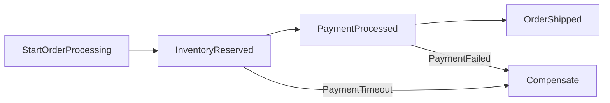

# Building Your First Saga

A saga coordinates a multi-step business process where failure in one step requires undoing previous steps. Unlike a database transaction, a saga cannot simply roll back. Instead, each step publishes a command, the saga suspends until it receives a response event, and compensation logic is built into the event handlers.

This guide walks through building a realistic saga from scratch: an order fulfillment process that reserves inventory, charges payment, and schedules shipping. Along the way, you will see how to handle failures, schedule timeouts, and keep your system consistent.

## Before You Start

- **.NET 10.0**
- Install the required packages:
  ```bash
  dotnet add package Excalibur.Saga
  dotnet add package Excalibur.Saga.SqlServer  # or your provider
  ```
- Familiarity with [Dispatch pipeline](../pipeline/index.md) and [dependency injection](../core-concepts/dependency-injection.md)

## When Do You Need a Saga?

Not every multi-step operation needs a saga. Use this as a guide:

| Scenario | Solution |
|----------|----------|
| All writes go to one database | Use a database transaction |
| Two services, one can retry idempotently | Use the outbox pattern with retry |
| Multiple services, failure requires rollback of earlier steps | **Use a saga** |
| Long-running process with human approval steps | **Use a saga** with suspension |

The key question: **"If step 3 fails, do I need to undo steps 1 and 2?"** If yes, you need a saga.

## The Scenario

An e-commerce order fulfillment process with three steps:

1. **Reserve inventory** -- Put items on hold so they cannot be sold to someone else
2. **Process payment** -- Charge the customer's payment method
3. **Schedule shipping** -- Create a shipment with the carrier

Each step is triggered by an event. If payment fails, we must release the inventory reservation. If payment takes too long, a timeout fires to cancel the order.

The examples below form one managed application: keep the state, event and saga declarations together. The first registration explicitly selects in-memory state and timeout stores for local learning; it is not a durable deployment. The SQL alternative selects SQL-backed state and timeouts; neither example selects the atomic state-and-command profile.



## Step 1: Define the Saga State

The saga state holds all data shared across event handlers. It extends `SagaState`, which provides the built-in `SagaId`, processed event tracking, and serialization support.

```csharp
#nullable enable
using System.Collections.Generic;
using Excalibur.Saga.Orchestration;
using Excalibur.Dispatch.Messaging;

public class OrderSagaState : SagaState
{
    public string OrderId { get; set; } = string.Empty;
    public string CustomerId { get; set; } = string.Empty;
    public decimal TotalAmount { get; set; }

    // Populated as events arrive
    public string? ReservationId { get; set; }
    public string? PaymentTransactionId { get; set; }
    public string? ShipmentTrackingNumber { get; set; }
    public string? FailureReason { get; set; }
    public string? TimeoutId { get; set; }
    public List<string> CompletedSteps { get; set; } = [];
}
```

## Step 2: Define the Saga Events

Events must implement `ISagaEvent` so the `SagaCoordinator` can route them to the correct saga instance. Each event carries a `SagaId` to identify which saga it belongs to.

```csharp
#nullable enable
using Excalibur.Dispatch;

// Start event -- creates a new saga instance
public record StartOrderProcessing(
    string SagaId, string OrderId, string CustomerId, decimal TotalAmount) : ISagaEvent
{
    public string? StepId => null;
}

// Step completion events
public record InventoryReserved(string SagaId, string ReservationId) : ISagaEvent
{
    public string? StepId => null;
}
public record PaymentProcessed(string SagaId, string TransactionId) : ISagaEvent
{
    public string? StepId => null;
}
public record OrderShipped(string SagaId, string TrackingNumber) : ISagaEvent
{
    public string? StepId => null;
}

// Failure events
public record PaymentFailed(string SagaId, string Reason) : ISagaEvent
{
    public string? StepId => null;
}
```

## Step 3: Define a Timeout Message

Timeouts are also events. Define a timeout message for the payment deadline:

```csharp
#nullable enable
using Excalibur.Dispatch;

public sealed class PaymentTimeout : ISagaEvent
{
    public string SagaId { get; set; } = string.Empty;
    public string? StepId => "PaymentTimeout";
}
```

## Step 4: Implement the Saga

Extend `SagaBase<TState>` and implement `ISagaTimeout<T>` for declarative timeout handling:

```csharp
using System;
using System.Threading;
using System.Threading.Tasks;
using Excalibur.Dispatch;
using Excalibur.Saga.Abstractions;
using Excalibur.Saga.Orchestration;
using Excalibur.Dispatch.Messaging;
using Microsoft.Extensions.Logging;

public sealed partial class OrderFulfillmentSaga(
    OrderSagaState initialState,
    IDispatcher dispatcher,
    ILogger<OrderFulfillmentSaga> logger)
    : SagaBase<OrderSagaState>(initialState, dispatcher, logger),
      ISagaTimeout<PaymentTimeout>
{
    /// <summary>
    /// Declares which events this saga handles. The SagaCoordinator calls
    /// this to determine if an incoming event should be routed here.
    /// </summary>
    public override bool HandlesEvent(object eventMessage)
    {
        return eventMessage is StartOrderProcessing
            or InventoryReserved
            or PaymentProcessed
            or OrderShipped
            or PaymentFailed;
    }

    /// <summary>
    /// Processes saga events and advances the workflow.
    /// </summary>
    public override async Task<SagaEventOutcome> HandleAsync(
        object eventMessage, CancellationToken cancellationToken)
    {
        switch (eventMessage)
        {
            case StartOrderProcessing start:
                State.OrderId = start.OrderId;
                State.CustomerId = start.CustomerId;
                State.TotalAmount = start.TotalAmount;
                LogSagaStarted(State.SagaId, start.OrderId);

                // Schedule a payment timeout -- if payment is not
                // confirmed within 5 minutes, HandleTimeoutAsync fires
                State.TimeoutId = await RequestTimeoutAsync<PaymentTimeout>(
                    TimeSpan.FromMinutes(5), cancellationToken)
                    .ConfigureAwait(false);
                break;

            case InventoryReserved reserved:
                State.ReservationId = reserved.ReservationId;
                State.CompletedSteps.Add("ReserveInventory");
                break;

            case PaymentProcessed paid:
                State.PaymentTransactionId = paid.TransactionId;
                State.CompletedSteps.Add("ProcessPayment");

                // Cancel the payment timeout since we got confirmation
                if (State.TimeoutId is not null)
                {
                    await CancelTimeoutAsync(State.TimeoutId, cancellationToken)
                        .ConfigureAwait(false);
                }
                break;

            case OrderShipped shipped:
                State.ShipmentTrackingNumber = shipped.TrackingNumber;
                State.CompletedSteps.Add("ShipOrder");
                LogSagaCompleted(State.SagaId, State.OrderId);
                await MarkCompletedAsync(cancellationToken).ConfigureAwait(false);
                break;

            case PaymentFailed failed:
                State.FailureReason = failed.Reason;
                MarkCompleted();
                break;
            default:
                return SagaEventOutcome.Declined;
        }
        return SagaEventOutcome.Handled;
    }

    /// <summary>
    /// Called by the framework when a PaymentTimeout fires. Because the saga
    /// implements ISagaTimeout&lt;PaymentTimeout&gt;, this method is invoked
    /// directly instead of the general HandleAsync.
    /// </summary>
    public Task HandleTimeoutAsync(
        PaymentTimeout message, CancellationToken cancellationToken)
    {
        State.FailureReason = "Payment confirmation timed out";
        MarkCompleted();
        return Task.CompletedTask;
    }

    [LoggerMessage(Level = LogLevel.Information,
        Message = "Saga {SagaId} started for order {OrderId}")]
    private partial void LogSagaStarted(Guid sagaId, string orderId);

    [LoggerMessage(Level = LogLevel.Information,
        Message = "Saga {SagaId} completed for order {OrderId}")]
    private partial void LogSagaCompleted(Guid sagaId, string orderId);
}
```

Key points:
- **`HandlesEvent`** declares which event types this saga cares about. The `SagaCoordinator` uses this to route events.
- **`HandleAsync`** is called for each matched event. Use pattern matching to dispatch to the right logic.
- **`ISagaTimeout<PaymentTimeout>`** provides a dedicated `HandleTimeoutAsync` method that fires when the scheduled timeout expires.
- **`MarkCompleted()` / `MarkCompletedAsync()`** signals the saga is done. The state is persisted one final time.

## Step 5: Register and Configure

```csharp
using Excalibur.Saga.Orchestration;
using Microsoft.Extensions.DependencyInjection;

public static class SagaConfiguration
{
    public static IServiceCollection AddOrderSaga(this IServiceCollection services)
    {
        // Coordination does not choose persistence. Explicitly opt into
        // volatile state for this local example before registering the saga.
        services.AddInMemorySagaStore();
        services.AddExcaliburOrchestration();

        // Register timeout delivery (in-memory timeout store + delivery service)
        services.AddSagaTimeoutDelivery();

        // Register our saga type with the DI container
        services.AddSaga<OrderFulfillmentSaga, OrderSagaState>();

        // Map events so the coordinator knows which events start a new
        // saga instance vs. continue an existing one
        SagaRegistry.Register<OrderFulfillmentSaga, OrderSagaState>(info =>
        {
            info.StartsWith<StartOrderProcessing>();
            info.Handles<InventoryReserved>();
            info.Handles<PaymentProcessed>();
            info.Handles<OrderShipped>();
            info.Handles<PaymentFailed>();
            info.Handles<PaymentTimeout>();
        });

        return services;
    }
}
```

For SQL Server, use this **alternative** registration instead of `AddOrderSaga`. In this order, `UseSqlServer` selects both SQL-backed saga state and a SQL-backed timeout store; `WithTimeouts()` enables hosted delivery without replacing that selected store. Apply the state and timeout provider schemas before starting the host. This is ordinary persistence, not the [primary SQL atomic transition profile](index.md#state-only-and-atomic-durable-transitions):

```csharp
using Excalibur.Saga.Orchestration;
using Excalibur.Saga.SqlServer.DependencyInjection;
using Microsoft.Extensions.DependencyInjection;

public static class SqlOrderSagaConfiguration
{
    public static IServiceCollection AddSqlOrderSaga(
        this IServiceCollection services, string connectionString)
    {
        services.AddExcalibur(excalibur => excalibur.AddSagas(saga =>
        {
            saga.UseSqlServer(sql => sql.ConnectionString(connectionString))
                .WithCoordination()
                .WithTimeouts();
        }));
        services.AddSaga<OrderFulfillmentSaga, OrderSagaState>();
        SagaRegistry.Register<OrderFulfillmentSaga, OrderSagaState>(info =>
        {
            info.StartsWith<StartOrderProcessing>();
            info.Handles<InventoryReserved>();
            info.Handles<PaymentProcessed>();
            info.Handles<OrderShipped>();
            info.Handles<PaymentFailed>();
            info.Handles<PaymentTimeout>();
        });
        return services;
    }
}
```

## What Happens When It Works

```
StartOrderProcessing    → State created, payment timeout scheduled (5 min)
InventoryReserved       → ReservationId stored, step marked complete
PaymentProcessed        → TransactionId stored, timeout cancelled
OrderShipped            → TrackingNumber stored, saga marked completed
```

## What Happens When It Fails

### Payment Fails

```
StartOrderProcessing    → State created, timeout scheduled
InventoryReserved       → ReservationId stored
PaymentFailed           → FailureReason set, saga marked completed

Result: Saga knows inventory was reserved but payment failed.
Your event handlers for PaymentFailed can publish compensation
commands (e.g., ReleaseInventory) to undo earlier steps.
```

### Payment Times Out

```
StartOrderProcessing    → State created, timeout scheduled (5 min)
InventoryReserved       → ReservationId stored
... 5 minutes pass, no PaymentProcessed event ...
PaymentTimeout          → HandleTimeoutAsync fires, saga completed with failure reason

Result: Saga ended gracefully instead of hanging indefinitely.
```

## Compensation in Event-Driven Sagas

In the event-driven model, compensation is handled explicitly in your event handlers rather than automatically by the framework. When a failure event arrives, your saga can:

1. **Buffer compensation commands** through `SendCommandAsync`, which the coordinator flushes after the state save. The base dispatcher is private. For example, replace the `PaymentFailed` branch with a call to the application method below:

```csharp
using System.Threading;
using System.Threading.Tasks;
using Excalibur.Dispatch;

public sealed record ReleaseInventoryCommand(string OrderId, string ReservationId)
    : IDispatchAction;

public sealed partial class OrderFulfillmentSaga
{
    private async Task CompensatePaymentFailureAsync(
        PaymentFailed failed, CancellationToken cancellationToken)
    {
        State.FailureReason = failed.Reason;
        if (State.ReservationId is not null)
        {
            await SendCommandAsync(
                new ReleaseInventoryCommand(State.OrderId, State.ReservationId),
                cancellationToken).ConfigureAwait(false);
        }
        await MarkCompletedAsync(cancellationToken).ConfigureAwait(false);
    }
}
```

2. **Track compensation state** in the saga state so you know what needs undoing.

Implement an idempotent handler for the application-owned `ReleaseInventoryCommand`; the snippet does not claim an external inventory service exists. Ordinary buffered commands can be stranded by a crash after state commit. Use the separately documented atomic profile when durable command intent is required. Compensation ordering remains application-owned.

## Idempotent Event Replay

`SagaState` remembers which deliveries a saga has already processed, keyed on the **envelope message ID the delivery carries** (`IMessageContext.MessageId`). If the same delivery arrives twice — a crash replay, a transport redelivery — the `SagaCoordinator` skips it without invoking your handler. `StepId` plays no part in this.

Two limits are worth knowing before you rely on it:

- The remembered set holds **1,000 identities per saga instance** and evicts the oldest first, so a redelivery past that bound runs the step again.
- A delivery that carries **no** message ID is processed and **not** deduplicated — the framework will not invent an identity. It logs a warning the first time each event type does this and counts every occurrence in `excalibur.saga.undeduplicable_deliveries`.

**So write idempotent handlers.** The set is a bounded window, not exactly-once; if you need unbounded deduplication, put the transactional inbox in front of the saga.

## Common Mistakes

### 1. Forgetting to cancel timeouts

If you schedule a timeout but the step completes successfully, always cancel the timeout:

```csharp
using System.Threading;
using System.Threading.Tasks;

public sealed partial class OrderFulfillmentSaga
{
    private async Task CancelConfirmedPaymentTimeoutAsync(CancellationToken cancellationToken)
    {
        if (State.TimeoutId is not null)
        {
            await CancelTimeoutAsync(State.TimeoutId, cancellationToken)
                .ConfigureAwait(false);
        }
    }
}
```

### 2. Not using ConfigureAwait(false)

In library code (which sagas are), always use `ConfigureAwait(false)` on awaits:

```csharp
using System.Threading;
using System.Threading.Tasks;

public sealed partial class OrderFulfillmentSaga
{
    private async Task CompleteWithoutCapturingContextAsync(CancellationToken cancellationToken)
    {
        await MarkCompletedAsync(cancellationToken).ConfigureAwait(false);
    }
}
```

### 3. Not implementing ISagaTimeout for timeout messages

If you schedule a timeout but don't implement `ISagaTimeout<T>`, the timeout message falls through to `HandleAsync` as a regular event. This works but loses the type-safety benefit:

```csharp
using System.Threading;
using System.Threading.Tasks;
using Excalibur.Dispatch;
using Excalibur.Dispatch.Messaging;
using Excalibur.Saga.Abstractions;
using Excalibur.Saga.Orchestration;
using Microsoft.Extensions.Logging;

// A separate minimal example of the typed-timeout contract.
public sealed class PaymentTimeoutExampleSaga(
    OrderSagaState state, IDispatcher dispatcher, ILogger<PaymentTimeoutExampleSaga> logger)
    : SagaBase<OrderSagaState>(state, dispatcher, logger), ISagaTimeout<PaymentTimeout>
{
    public override bool HandlesEvent(object message) => message is PaymentTimeout;

    public override Task<SagaEventOutcome> HandleAsync(object message, CancellationToken ct)
        => Task.FromResult(SagaEventOutcome.Declined);

    public Task HandleTimeoutAsync(PaymentTimeout message, CancellationToken ct)
    {
        State.FailureReason = "Payment confirmation timed out";
        MarkCompleted();
        return Task.CompletedTask;
    }
}
```

## Next Steps

- [Orchestration vs Choreography](orchestration-vs-choreography.md) -- Compare centralized and decentralized saga coordination
- [Outbox Pattern](../patterns/outbox.md) -- Reliable event publishing from saga steps
- [Event Sourcing](../event-sourcing/index.md) -- Store domain state as events

## See Also

- [Sagas Overview](index.md) -- Saga concepts, packages, and builder extensions
- [Orchestration vs Choreography](orchestration-vs-choreography.md) -- Choosing the right coordination pattern
